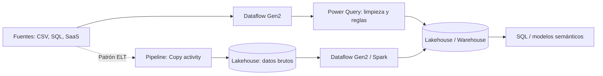
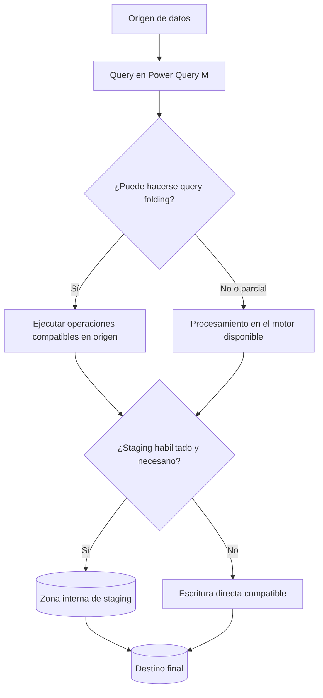
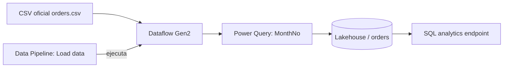

# 01 · Ingest Data with Dataflows Gen2 in Microsoft Fabric

> **Certificación:** DP-700 · Microsoft Fabric Data Engineer Associate. **Ruta:** Ingest data with Microsoft Fabric. **Revisión:** 23/11/2026.  
> **Estado:** desarrollo teórico de las siete unidades y laboratorio oficial documentado. **Ejecución:** no realizada; las salidas son verificaciones previstas, nunca resultados observados.  
> **Origen:** [módulo de Microsoft Learn](https://learn.microsoft.com/en-us/training/modules/use-dataflow-gen-2-fabric/) · [index.yml y fuentes](https://github.com/MicrosoftDocs/learn/tree/main/learn-pr/wwl/use-dataflow-gen-2-fabric) · [laboratorio oficial](https://github.com/MicrosoftLearning/mslearn-fabric/blob/main/Instructions/Labs/05-dataflows-gen2.md).

## Índice

1. [Introduction](#1-introduction)
2. [Understand Dataflows Gen2 in Microsoft Fabric](#2-understand-dataflows-gen2-in-microsoft-fabric)
3. [Explore Dataflows Gen2 in Microsoft Fabric](#3-explore-dataflows-gen2-in-microsoft-fabric)
4. [Integrate Dataflows Gen2 and Pipelines](#4-integrate-dataflows-gen2-and-pipelines)
5. [Exercise: create and use a Dataflow](#5-exercise-create-and-use-a-dataflow)
6. [Knowledge check: preguntas razonadas](#6-knowledge-check-preguntas-razonadas)
7. [Summary: criterios de ingeniería](#7-summary-criterios-de-ingeniería)
8. [Fuentes y control de calidad](#8-fuentes-y-control-de-calidad)

## 1. Introduction

La unidad introductoria de Microsoft Learn plantea la ingesta como primera fase de una solución analítica y sitúa Dataflows Gen2 dentro de Data Factory. Un Dataflow no es simplemente una consulta que lee una tabla: representa un proceso mantenible de extracción, preparación y, cuando se configura un destino, carga. Separa las decisiones de limpieza y enriquecimiento de las consultas individuales de los analistas.

### 1.1. Por qué centralizar la preparación

En un escenario de ventas corporativo, un área recibe CSV diarios; otra, datos relacionales; y una tercera, extractos de un sistema de terceros. Cada fuente define esquemas y convenciones propias. Si el equipo de BI replica las mismas reglas en diez modelos semánticos independientes, cualquier cambio de negocio implica modificar diez lugares y aumenta la probabilidad de obtener indicadores inconsistentes.

Diseñar una capa de preparación reutilizable no elimina la necesidad de gobernanza. Hace explícitas las reglas de negocio: un cambio en la conversión monetaria, un filtrado de registros cancelados o un ajuste de zonas horarias se define en un proceso compartido, se valida y se publica para distintos consumidores. El modelo semántico sigue siendo otra capa que define relaciones, medidas y seguridad de consumo. **Dataflow y semantic model tienen responsabilidades diferentes.**

### 1.2. Objetivos que deben alcanzarse

Al terminar las siete unidades se debe explicar qué funciones cubre Dataflows Gen2, configurar una fuente y transformaciones con Power Query Online, escoger un destino y su método de actualización, incluir el Dataflow en la orquestación de un Pipeline y analizar el historial de ejecución. Se estudian también los riesgos de cargas repetidas, el consumo de capacidad, la ausencia de row-level security propia en Dataflow y las condiciones que favorecen o dificultan query folding.

**Problema guía del módulo:** convertir pedidos de un origen CSV en una tabla analítica de un Lakehouse, obteniendo de la fecha del pedido una columna de mes, y poder repetir el proceso desde un Pipeline. Es un caso deliberadamente sencillo para aislar la semántica de la tecnología.

## 2. Understand Dataflows Gen2 in Microsoft Fabric

**Fuente nuclear:** [unidad oficial](https://learn.microsoft.com/en-us/training/modules/use-dataflow-gen-2-fabric/2-dataflows-gen-2) y [Markdown fuente](https://github.com/MicrosoftDocs/learn/blob/main/learn-pr/wwl/use-dataflow-gen-2-fabric/includes/2-dataflows-gen-2.md). El desarrollo siguiente es explicación propia ampliada.

### 2.1. Problema que resuelve la tecnología

Una organización rara vez recibe todos sus datos en un único sistema y con el mismo diseño. Las ventas pueden almacenarse en una base de datos relacional; los precios pueden llegar como CSV; las campañas, mediante un servicio SaaS; y los eventos, mediante un sistema de streaming. Antes de producir indicadores fiables hay que homogeneizar nombres, tipos, claves y reglas de negocio. Esta fase es la **preparación de datos**, una tarea distinta de la visualización y del modelado semántico.

Imaginemos una cadena de tiendas que recibe diariamente pedidos. El sistema operacional utiliza `OrderDate` con tipo fecha, otro archivo representa esa columna como texto y algunos registros contienen importes nulos, duplicados o códigos regionales inconsistentes. Si cada analista corrige esos problemas de forma distinta en Power BI, los resultados divergen. Un Dataflow Gen2 puede centralizar buena parte de las reglas de preparación antes de que diferentes consumidores consulten el resultado.

**Dataflow Gen2** es un elemento de Microsoft Fabric, integrado con Data Factory, para definir transformaciones de datos con **Power Query Online**. Permite conectarse a fuentes, aplicar transformaciones mediante una interfaz de bajo código y escribir resultados en destinos analíticos. No equivale a «una tabla» ni a «un informe»: es una **definición ejecutable de un proceso de transformación**. Tampoco implica que cualquier transformación sea gratuita o que se ejecute siempre en el sistema de origen.

### 2.2. ETL frente a ELT: dónde sucede la transformación

El orden de las operaciones modifica la arquitectura:

| Fase | ETL | ELT |
| --- | --- | --- |
| Extract | Leer desde la fuente | Leer desde la fuente |
| Transform | Aplicar limpieza antes de guardar el resultado definitivo | Transformar después de una primera carga |
| Load | Guardar el resultado transformado | Guardar primero los datos extraídos en una zona de aterrizaje |
| Ejemplo en Fabric | Dataflow Gen2 transforma y escribe una tabla curada | Pipeline copia datos brutos a Lakehouse; después Dataflow Gen2 o Spark transforma |
| Cuándo es útil | Reglas controladas y poco código | Conservar el dato original, reprocesar, escalar transformaciones |

Una arquitectura **ETL** puede ser suficiente cuando un CSV moderado llega a una frecuencia conocida y el objetivo es producir una tabla de consulta. La transformación ocurre en el flujo antes de escribir la tabla que se consumirá. Una arquitectura **ELT** suele aportar mejores posibilidades de trazabilidad si es obligatorio conservar los datos brutos intactos y poder reconstruir resultados tras cambiar una regla de negocio.

No existe una separación absoluta: un Dataflow Gen2 puede consumir datos ya cargados en un Lakehouse y generar otra tabla; un pipeline puede incluir tanto actividades de copia como transformaciones. «ETL» y «ELT» describen **secuencias lógicas**, no nombres exclusivos de productos.



*Diagrama propio. Las flechas continuas muestran un ETL representativo y las discontinuas el inicio alternativo de un ELT.*

### 2.3. Las piezas de un Dataflow Gen2

Un Dataflow Gen2 combina varios conceptos que conviene distinguir:

**Conexión (connection).** Contiene la configuración necesaria para acceder a un origen o destino. Dependiendo del conector puede utilizar autenticación organizativa, credenciales de base de datos o acceso anónimo. Las conexiones se ejecutan dentro del contexto de permisos definido para el elemento y no constituyen por sí solas autorizaciones sobre cualquier tabla de Fabric.

**Query.** Es la unidad de transformación lógica que Power Query presenta en el editor. La query parte de una fuente o de otra query, aplica pasos y devuelve un resultado tabular u otro valor. Pueden existir queries intermedias sin destino final, queries compartidas por referencia y queries que escriben tablas. Una query no es automáticamente una tabla persistente: la persistencia exige configurar una salida o utilizar el mecanismo de consumo compatible.

**Applied Steps.** Son las transformaciones secuenciales de una query: cambio de tipo, filtrado, normalización, fusión de tablas, cálculo de columnas, agrupación, etc. El orden importa. Si intentamos extraer el mes de una columna de texto que no se ha convertido a `date`, podemos obtener errores; por eso suele ser preferible normalizar el tipo antes de aplicar `Date.Month`.

**Power Query M.** Es el lenguaje funcional que expresa la lógica de Power Query. La interfaz visual no sustituye al lenguaje: al pulsar botones, el editor construye expresiones M. El **Advanced editor** permite examinarlas, aprender qué hace cada paso y, cuando sea apropiado, modificarlas de forma explícita.

**Data Destination.** Es el destino de los datos preparados. Para los escenarios de este curso se utilizan, entre otros, Lakehouse y Warehouse. Debemos distinguir la tabla de salida de un Dataflow y el objeto semántico de Power BI que después la consulta. Un Dataflow no es, por sí mismo, un modelo semántico y tampoco aplica por defecto las mismas políticas de seguridad del consumidor final.

**Refresh.** Ejecuta la definición. Se puede realizar manualmente, programar o integrar en un pipeline. La ejecución materializa datos según la configuración y la política de escritura del destino, y consume capacidad o recursos correspondientes. Guardar el diseño no equivale a haber producido una carga completa.

### 2.4. Flujo de ejecución: de la fuente al almacenamiento

Al diseñar un Dataflow conectamos una query a una fuente, escogemos transformaciones y configuramos un destino. Durante la ejecución, el motor de Power Query evalúa los pasos y coordina el movimiento y el procesamiento. Según el origen, las operaciones y la configuración, algunas transformaciones pueden delegarse al sistema de origen mediante **query folding**; otras se ejecutan en los motores gestionados por Fabric.

Es esencial comprender el concepto de **staging**. Una query puede depositar resultados intermedios en un almacenamiento interno gestionado por Dataflows. Microsoft documenta que esta zona se usa para realizar determinadas transformaciones o facilitar la escritura en destinos. El staging **no debe confundirse con el Lakehouse gobernado por el usuario** al que se ha decidido publicar la tabla final: pueden tener propósitos, ciclos de vida y acceso diferentes. Tampoco debemos modificar manualmente los Lakehouses internos de staging.

El comportamiento concreto depende de si se ha activado staging, del tipo de destino y de las opciones del flujo. No es correcto afirmar que todo Dataflow siempre crea y usa el mismo Lakehouse de staging o que todo se ejecuta en Spark. La documentación de precios diferencia motores de evaluación y tipos de consumo, por lo que las características reales deben revisarse para cada configuración.



*Diagrama conceptual propio: no representa una garantía de motor, rendimiento o plan de ejecución.*

### 2.5. Query folding: por qué es importante

**Query folding** significa que Power Query puede traducir algunas transformaciones a operaciones que ejecute directamente la fuente, como una consulta SQL con `WHERE`, un subconjunto de columnas o una agregación compatible. En lugar de transportar millones de filas y filtrarlas después, puede obtenerse directamente el conjunto ya reducido. Esto disminuye el volumen movido y, según la arquitectura, puede mejorar latencia y consumo.

Supongamos una tabla SQL con 20 millones de pedidos y una query que filtra `OrderDate >= 2026-01-01`. Si la fuente y los pasos admiten folding, el filtro puede materializarse en la consulta SQL. Pero si antes realizamos una transformación M que la fuente no sabe traducir, es posible perder la capacidad de delegar los pasos posteriores. Por eso, como buena práctica, se deben colocar temprano los filtros y la selección de columnas, sin suponer que todos los conectores admiten folding.

**Tres resultados posibles:** folding completo (las operaciones relevantes se delegan), parcial (solo determinadas operaciones) y ausente (se procesa fuera de la fuente). La estrategia de optimización depende de los indicadores del editor y de la documentación del conector. Un archivo CSV descargado por HTTPS no es una base SQL capaz de ejecutar filtros remotos arbitrarios; en ese caso, el concepto de folding no ofrece las mismas oportunidades.

Para cargas grandes, Microsoft recomienda aprovechar las operaciones delegables y, cuando proceda, separar el último paso que admite folding del resto mediante queries intermedias y staging. Si las transformaciones son computacionalmente pesadas, no debemos utilizar Dataflows Gen2 por defecto sin valorar PySpark, T-SQL y otras alternativas.

[Referencia oficial: query folding](https://learn.microsoft.com/en-us/power-query/query-folding-basics) · [Referencia oficial: optimización de Dataflow Gen2](https://learn.microsoft.com/en-us/fabric/data-factory/dataflow-gen2-performance-best-practices)

### 2.6. Reutilización y responsabilidades de Dataflow, Pipeline y Notebook

Un Dataflow Gen2 concentra la lógica de preparación. Un **Data Pipeline** define la **orquestación**: qué actividad empieza, de qué depende, qué ocurre si falla y cómo se activa. Un **Notebook** permite implementar código más flexible, normalmente con Spark/PySpark para el procesamiento distribuido o mediante otros lenguajes y bibliotecas disponibles.

| Necesidad | Dataflow Gen2 | Data Pipeline | Notebook / Spark |
| --- | --- | --- | --- |
| Preparación de datos low-code | Principal fortaleza | Orquesta, no reemplaza por sí solo la transformación compleja | Posible mediante código |
| Copia y movimiento entre sistemas | Conectores y destinos compatibles | Actividades especializadas de copia | Código y conectores |
| Dependencias entre actividades | Puede ejecutarse como una actividad | **Función central** | Puede invocarse desde pipeline |
| Lógica específica compleja | Limitada por transformaciones y conectores disponibles | Coordina otras actividades | Muy flexible |
| Procesamiento distribuido programático | Depende de capacidades y motores disponibles; no asumir Spark en cualquier query | Orquesta | Principal alternativa con PySpark |
| Mantenimiento para analistas | Interfaz visual familiar | Editor visual de actividades | Requiere conocimientos de programación |

En un escenario empresarial, una combinación frecuente es: pipeline de ingesta → dataflow de transformación → notebook o procedimiento de control adicional → publicación de tablas analíticas. El orden y los componentes finales dependen de si se preservan los brutos, de la frecuencia, de los SLA y de las dependencias entre cargas.

**Ejemplo de dependencia importante.** Una tabla de ventas no debería publicarse como «lista para reporting» si todavía no se han cargado los clientes necesarios para resolver sus claves de dimensión. El pipeline es el lugar apropiado para expresar esa dependencia operativa; no se resuelve simplemente encadenando fórmulas dentro de Power Query.

### 2.7. Ejemplo propio en Power Query M: preparación de pedidos

El ejemplo siguiente es **complementario, inventado para estudiar la tecnología**, y no forma parte del laboratorio de Microsoft. Usa datos en memoria con `#table`, de modo que podemos comprender M sin depender de credenciales, URLs o del esquema exacto del CSV oficial. Representa una ingesta de cinco filas, incluida una repetición y dos registros inválidos.

```powerquery
let
    // 1. Fuente tabular de ejemplo, declarada con tipos explícitos.
    Source = #table(
        type table [OrderID = Int64.Type, OrderDate = date,
                    Amount = number, Region = text],
        {
            {1001, #date(2026, 1, 12), 120.50, "Norte"},
            {1001, #date(2026, 1, 12), 120.50, "Norte"},
            {1002, #date(2026, 2, 5),  -30.00, "Sur"},
            {1003, #date(2026, 2, 17), null,   "Norte"},
            {1004, #date(2026, 2, 25), 80.00,  "Sur"}
        }
    ),

    // 2. Excluimos registros sin información válida para este ejemplo.
    ValidOrders = Table.SelectRows(
        Source,
        each [OrderID] <> null
             and [OrderDate] <> null
             and [Amount] <> null
             and [Amount] >= 0
    ),

    // 3. Eliminamos duplicados por identificador de pedido.
    //    Esta estrategia es segura solo si OrderID identifica realmente
    //    un pedido y la regla de conservación está definida.
    DistinctOrders = Table.Distinct(ValidOrders, {"OrderID"}),

    // 4. Añadimos atributos de tiempo para las agregaciones.
    AddYear = Table.AddColumn(
        DistinctOrders, "Year", each Date.Year([OrderDate]), Int64.Type
    ),
    AddMonthNo = Table.AddColumn(
        AddYear, "MonthNo", each Date.Month([OrderDate]), Int64.Type
    ),

    // 5. Obtenemos ventas mensuales por región.
    MonthlySales = Table.Group(
        AddMonthNo,
        {"Year", "MonthNo", "Region"},
        {
            {"OrderCount", each Table.RowCount(_), Int64.Type},
            {"TotalAmount", each List.Sum([Amount]), type number}
        }
    )
in
    MonthlySales
```

**Lectura del código.** La sintaxis `let … in` define nombres de pasos y devuelve el valor del último paso. Cada función de `Table.*` recibe una tabla y produce otra, de forma que los pasos forman una cadena declarativa. `Date.Year` y `Date.Month` extraen información temporal de valores de tipo `date`. `Table.Group` materializa una agregación por año, mes y región; `Table.RowCount(_)` calcula el tamaño de cada grupo, mientras que `List.Sum([Amount])` suma los importes del subconjunto actual.

**Resultado lógico esperado (no ejecutado en Fabric):**

| Year | MonthNo | Region | OrderCount | TotalAmount |
| ---: | ---: | --- | ---: | ---: |
| 2026 | 1 | Norte | 1 | 120,50 |
| 2026 | 2 | Sur | 1 | 80,00 |

Cinco filas de entrada → descartamos el pedido negativo y el importe nulo → quedan tres filas → eliminamos el duplicado de `1001` → quedan dos pedidos válidos → agrupamos. Es una **validación razonada del ejemplo**, no el resultado de una ejecución de laboratorio. En un caso real, valores negativos podrían ser devoluciones legítimas, y la eliminación de duplicados requeriría definir qué versión prevalece; aquí se simplifica con fines didácticos.

**Advertencia sobre claves.** `Table.Distinct` con una clave no debe interpretarse como una deduplicación histórica con precedencia determinista. Cuando hay revisiones de pedidos, conviene definir una versión o marca temporal, ordenar según la regla de negocio y utilizar un mecanismo que garantice una única fila ganadora. Para historificación o cargas incrementales complejas habrá que estudiar tablas Delta, procesos `MERGE` y modelos dimensionales en otros módulos.

### 2.8. Escritura al destino: Append, Replace e idempotencia

Después de preparar una query hay que definir dónde se escriben sus resultados. En este punto aparece una decisión crítica: **Append** o **Replace** (cuando están disponibles en el destino y configuración específicos).

**Append** añade nuevos datos a la tabla de destino. Se utiliza en escenarios de histórico acumulativo cuando hay un mecanismo fiable para detectar qué registros son nuevos o para impedir duplicados. Si se ejecuta dos veces exactamente la misma carga completa con Append, se corre el riesgo de duplicar los pedidos. **Replace** sustituye datos según la semántica configurada del destino; puede ser adecuado en reconstrucciones completas y tablas pequeñas de referencia, pero debe evaluarse antes de utilizarlo con históricos.

La **idempotencia** es una propiedad por la que ejecutar nuevamente una operación con la misma entrada no cambia el estado final después de la primera aplicación. Un pipeline reintentado tras un fallo puede duplicar datos si su escritura no es idempotente. Por tanto, para cargas repetibles es preciso diseñar un identificador de ejecución, un watermark o un procedimiento de actualización consistente; la presencia de un dataflow no aporta automáticamente una estrategia incremental segura.

La configuración exacta de Append y Replace, sus requisitos y sus excepciones cambian según el destino; la fuente oficial de referencia es [Dataflow Gen2 data destinations and managed settings](https://learn.microsoft.com/en-us/fabric/data-factory/dataflow-gen2-data-destinations-and-managed-settings). En la parte práctica se conserva **Append** porque es el ajuste prescrito por el laboratorio, pero se explica expresamente el riesgo de repetir la ejecución.

### 2.9. Seguridad, gobernanza y calidad

Un Dataflow Gen2 no debe confundirse con una frontera completa de seguridad. La unidad oficial advierte que la seguridad de nivel de fila (**Row-Level Security**, RLS) no se implementa en el propio Dataflow del modo en que se aplica en los elementos y motores que la soportan. Eso **no significa** que RLS sea imposible en otros elementos de Fabric: existen controles en Warehouse, modelos semánticos y otras capas. La autorización debe diseñarse en los objetos que almacenan o sirven el dato.

Se deben considerar cuatro responsabilidades:

1. **Identidad y acceso a fuentes:** qué cuenta conecta, qué objetos puede leer y si se necesitan gateways o permisos de red.
2. **Permisos de destino:** quién puede crear, escribir, modificar o consultar las tablas del Lakehouse o Warehouse.
3. **Sensibilidad de los datos:** evitar publicar datos personales en tablas accesibles más ampliamente de lo necesario; aplicar las políticas organizativas de protección de información.
4. **Evidencia operativa:** conservar el estado de las ejecuciones, el número de registros procesados y la causa de los fallos para poder investigar incidencias.

No deben incrustarse contraseñas ni tokens en ejemplos M ni en los README. Tampoco debe confiarse en la vista previa como prueba de calidad completa: muestra un subconjunto, mientras que las reglas de integridad y las verificaciones postcarga deben comprobar el conjunto de salida o una muestra controlada y representativa.

### 2.10. Costes, rendimiento y límites

Dataflows Gen2 requiere un workspace con capacidad Fabric o un modo compatible (en el laboratorio se admite trial). Ejecutar transformaciones, mover datos y utilizar almacenamiento intermedio puede consumir recursos; la facturación depende del motor, la capacidad y la modalidad. No sería correcto incluir en unos apuntes una «tarifa fija por ejecución» sin conocer el tipo de capacidad y el motor utilizados.

Como optimización, se recomienda **filtrar lo antes posible**, reducir columnas innecesarias, aprovechar query folding en fuentes compatibles, observar el comportamiento de staging y comparar el coste real de la operación frente a alternativas con Spark o T-SQL. En proyectos grandes conviene separar cargas, medir latencia y monitorizar capacidad. Las funciones de Fast Copy o staging pueden ayudar en determinados escenarios; no garantizan siempre una mejora.

Una restricción concreta documentada por Microsoft es el límite de **hasta 50 queries por Dataflow Gen2 que tengan staging o un destino configurado** (las auxiliares que no escriben ni hacen staging quedan fuera del conteo). También existen límites de conectores, gateways, nombres de columnas y validación de publicación. Para una certificación, debemos contrastar estos detalles con la documentación vigente cuando se estudie.

**Referencias técnicas:** [precios y consumo](https://learn.microsoft.com/en-us/fabric/data-factory/pricing-dataflows-gen2), [limitaciones actuales](https://learn.microsoft.com/en-us/fabric/data-factory/data-factory-limitations), [buenas prácticas de rendimiento](https://learn.microsoft.com/en-us/fabric/data-factory/dataflow-gen2-performance-best-practices).

### 2.11. Errores conceptuales habituales y puntos de examen

| Afirmación o síntoma | Diagnóstico correcto |
| --- | --- |
| «Un Dataflow Gen2 es un Data Warehouse» | No. El Dataflow define procesamiento; el Warehouse es un destino analítico con su propio motor y modelo de seguridad. |
| «Cada Dataflow contiene obligatoriamente un Data Pipeline» | No. Pueden ser elementos separados; el pipeline puede orquestar un Dataflow. |
| «Power Query Online solo sirve para Power BI» | No. Se utiliza para ingesta y preparación con destinos de Fabric. |
| «Si veo cinco filas en la preview, he cargado cinco filas» | No. La vista previa no prueba que el destino se haya actualizado correctamente. |
| «El pipeline terminó, por tanto la tabla es correcta» | Un estado satisfactorio indica que la actividad terminó según su mecanismo; siguen siendo necesarias comprobaciones de tipos, filas y reglas de negocio. |
| «Append siempre funciona bien con reintentos» | No. Si se repiten los mismos registros, puede producir duplicados. |
| «Un Dataflow aplica RLS a todos sus consumidores» | No. La seguridad fina corresponde a las capas y elementos compatibles; hay que diseñarla expresamente. |
| «Una transformación M se ejecuta siempre en Spark» | No. Depende del tipo de Dataflow, el motor y la configuración. |

**Preguntas que deberías poder responder tras estudiar esta unidad:** ¿En qué se diferencian ETL y ELT en una solución Fabric? ¿Cuándo elegir Dataflow frente a Notebook? ¿Qué función cumple un Pipeline? ¿Qué es una query de Power Query y en qué se diferencia de una tabla persistente? ¿Por qué puede ser crucial query folding? ¿Cuál es el riesgo de ejecutar una carga completa con Append más de una vez? ¿Dónde deben aplicarse controles de acceso granulares?

---

## 3. Explore Dataflows Gen2 in Microsoft Fabric

**Fuente específica:** [unidad oficial](https://learn.microsoft.com/en-us/training/modules/use-dataflow-gen-2-fabric/3-explore-dataflows-gen-2) y [archivo de MicrosoftDocs](https://github.com/MicrosoftDocs/learn/blob/main/learn-pr/wwl/use-dataflow-gen-2-fabric/includes/3-explore-dataflows-gen-2.md).

### 3.1. Recorrido por el editor: entender cada zona, no memorizar botones

La interfaz de Dataflows Gen2 reutiliza Power Query Online. El **ribbon** reúne los conectores y operaciones; el panel **Queries** identifica las consultas y dependencias; el **Data Preview** permite inspeccionar resultados parciales; **Query Settings** contiene la cadena de Applied Steps; y **Diagram View** ayuda a comprender transformaciones encadenadas. El **Advanced editor** presenta el lenguaje Power Query M que describe realmente las consultas. Estas vistas no son cinco motores diferentes: son representaciones y controles de una misma definición de transformación.

Una query representa una expresión tabular. Su nombre no equivale necesariamente a una tabla física: si no se habilita una escritura a destino, no tiene por qué materializarse como una tabla en OneLake. Además, una consulta puede referenciar otra consulta del mismo Dataflow. Esto permite construir una consulta base que normalice la entrada y derivar de ella distintas salidas sin repetir manualmente el conjunto de pasos. **Duplicar** una query y **referenciar** una query responden a necesidades distintas: una copia permite evolucionar de forma independiente; una referencia expresa una dependencia lógica de la salida con la consulta origen. No debe suponerse que el motor evalúa una referencia exactamente una vez ni que garantiza caché de resultados para todo escenario.

### 3.2. Applied Steps y su traducción conceptual a M

Cada operación visual crea normalmente un paso en el bloque let de M. Las transformaciones son composables: un paso consume el resultado del anterior y crea un valor nuevo. Puede haber operaciones que cambien el esquema, como quitar columnas o convertir tipos, y otras que cambien el conjunto de filas, como filtrar o quitar duplicados. Por eso el **orden** altera el resultado y el rendimiento: filtrar antes de un join puede reducir las filas que deben participar en la combinación; convertir una clave de forma inconsistente puede producir un join sin coincidencias.

~~~powerquery
let
    Pedidos = #table(
        type table [Id = Int64.Type, Region = text, Cantidad = Int64.Type, Precio = number],
        {{1, "norte", 2, 40.0}, {2, "sur", 1, 15.0}, {3, "norte", 3, 10.0}}
    ),
    RegionNormalizada = Table.TransformColumns(Pedidos, {{"Region", Text.Upper, type text}}),
    Importe = Table.AddColumn(RegionNormalizada, "Importe", each [Cantidad] * [Precio], type number),
    SoloImportes = Table.SelectRows(Importe, each [Importe] > 20)
in
    SoloImportes
~~~

*Ejemplo propio, autocontenido y sin llamadas a servicios.* El primer paso crea una tabla con esquema explícito. El segundo normaliza la región; el tercero calcula un importe; el cuarto devuelve solo registros por encima del umbral. El paso **in** establece qué valor será el resultado observable de la query. Cambiar el último paso puede devolver una versión anterior sin deshacer todos los pasos guardados.

### 3.3. Tipos, errores y pasos automáticos

Una conversión automática de Text a Date depende de que las cadenas puedan interpretarse según la configuración cultural y el formato. Fechas ambiguas como 03/04/2026 pueden representar días distintos. Para cargas fiables conviene comprobar la cultura del origen, garantizar una conversión explícita y capturar errores de tipado antes de escribir el destino. Una columna Decimal Number no siempre debe representar importes financieros con redondeo estricto: evaluar tipos de número decimal fijo y sus limitaciones de precisión es una decisión de ingeniería, no un cambio cosmético en la interfaz.

Data Preview es solo una vista parcial. Que el preview muestre diez filas correctas no valida una carga de millones de filas. Una verificación productiva necesita recuentos, distribución de nulos, integridad de claves y revisión de resultados en el destino tras la actualización.

### 3.4. Operaciones disponibles

| Operación | Finalidad | Riesgo que se debe revisar |
|---|---|---|
| Filter / Sort | Seleccionar o ordenar registros | Filtrar demasiado pronto y perder datos necesarios |
| Remove duplicates | Desduplicar | Elegir una clave insuficiente o un orden no determinista |
| Merge queries | Hacer un join por claves | Multiplicidad accidental y explosión de filas |
| Append queries | Concatenar conjuntos | Diferencias de tipos y columnas entre lotes |
| Pivot / Unpivot | Convertir dimensiones entre filas y columnas | Esquemas cambiantes con categorías nuevas |
| Split column | Separar campos compuestos | Separadores en texto libre y valores incompletos |
| Add conditional column | Implementar reglas | Condiciones solapadas y valores por defecto |
| Group by | Calcular agregaciones | Perder la granularidad original |

### 3.5. Destinos y configuración

La elección de destino no es una propiedad estética. Para un Lakehouse se materializan resultados como datos que podrán consultar Spark y herramientas analíticas; para un Warehouse se integran en el almacén relacional con su semántica de acceso. Microsoft documenta también otros destinos, pero **no deben suponerse disponibles idénticas operaciones en todos ellos**: los mecanismos de actualización, la evolución de esquema y el comportamiento de staging varían.

**Replace** reconstruye o sustituye el conjunto seleccionado según las reglas del destino y puede ser apropiado para tablas pequeñas de referencia. **Append** añade filas y exige resolver duplicados o controlar de dónde procede cada lote. La configuración incremental es otra dimensión: no equivale automáticamente a un MERGE por clave ni a Change Data Capture. Según el destino y las opciones activadas, refresh incremental procesa rangos de fechas y tiene requisitos y límites propios. Ver la [documentación de incremental refresh](https://learn.microsoft.com/en-us/fabric/data-factory/dataflow-gen2-incremental-refresh).

### 3.6. Diseño del esquema y observabilidad

Conviene establecer convenciones: identificar consultas de staging, consultas intermedias y consultas finales; documentar la granularidad de cada tabla; definir claves de negocio; nombrar las columnas con criterios consistentes; y comprobar el esquema antes y después de los pasos críticos. Si varias queries leen el mismo origen, estudiar su dependencia y el efecto de la materialización; si no se necesita una salida intermedia, evitar escribirla por comodidad. La estrategia deberá tener en cuenta credenciales, refresh, consumo de capacidad, destinos y trazabilidad.


## 4. Integrate Dataflows Gen2 and Pipelines

**Fuente específica:** [unidad de Microsoft Learn](https://learn.microsoft.com/en-us/training/modules/use-dataflow-gen-2-fabric/4-dataflow-pipeline) y [Markdown fuente](https://github.com/MicrosoftDocs/learn/blob/main/learn-pr/wwl/use-dataflow-gen-2-fabric/includes/4-dataflow-pipeline.md).

### 4.1. Separar transformación de orquestación

Un Dataflow Gen2 define cómo se leen, modifican y opcionalmente cargan los datos. Un **Pipeline** define cuándo se ejecutan las actividades, qué actividad depende de cuál, qué ocurre cuando una falla y cómo se combinan Dataflows con Copy Data, Notebooks o procedimientos. Esta separación permite reutilizar una misma transformación desde diferentes procesos sin duplicar sus pasos M.

~~~mermaid
flowchart LR
    A["Fuente CSV"] --> B["Dataflow Gen2"]
    B --> C["Tabla Silver en Lakehouse"]
    P["Pipeline programado"] --> D["Actividad Dataflow"]
    D -.ejecuta.-> B
    D --> E{"¿Éxito?"}
    E -->|Sí| F["Notebook: agregación Gold"]
    E -->|Error| G["Alerta / registro de fallo"]
    C --> F
~~~

**Diagrama de elaboración propia.** El resultado de una actividad permite condicionar el flujo; no debe interpretarse como una transacción única entre Dataflow y Notebook. Si la segunda actividad falla, la primera puede haber dejado datos persistidos. Hay que diseñar reintentos y compensación conscientemente.

### 4.2. Ejecución manual, programada y desencadenada

Para una carga aislada se puede ejecutar Dataflow directamente desde su interfaz. Para un proceso repetible, el Pipeline resulta más apropiado cuando se encadenan varios trabajos. La programación del Pipeline centraliza la secuencia; los triggers de eventos permiten reaccionar a determinadas condiciones del servicio. No se deben establecer simultáneamente un refresh automático del Dataflow y otro del Pipeline sin decidir si ambos están destinados a cargar el mismo origen. **Dos ejecuciones legítimas pueden crear una duplicación de datos si la carga es Append.**

### 4.3. Dependencias y control de fallo

Las dependencias de éxito, fallo y finalización tienen semánticas distintas. Conectar a la siguiente actividad «On completion» significa continuar independientemente del resultado de la primera. Para el caso clásico de ingesta seguida de transformación, lo normal es exigir **On success**, porque un Notebook no debería producir el Gold del día con una Bronze parcial o fallida. El patrón de compensación o aviso por error se conecta a una ruta separada.

Es frecuente confundir «el Pipeline ha terminado» con «los datos son correctos». La comprobación técnica confirma el estado de las actividades; una verificación de calidad necesita asegurar recuentos, tipos, duplicados, frescura de datos y restricciones de negocio. Por tanto, un Pipeline crítico debería añadir acciones de validación explícita antes de comunicar una ejecución satisfactoria a sus consumidores.

### 4.4. Caso alternativo ELT

Si se decide mantener el dato bruto para trazabilidad, Copy Data puede colocar el archivo en **Files/Bronze** y un Dataflow posterior leer ese conjunto para transformarlo. Esta separación permite reprocesar si cambia la lógica de negocio. Es una solución más auditable, aunque añade una segunda etapa y puede aumentar almacenamiento y ejecución. En procesos de gran volumen puede convenir una transformación distribuida con Spark en lugar de utilizar Power Query como único motor. La elección depende del tamaño, conectores, reglas, latencia, mantenimiento y coste.

### 4.5. Monitorización y recomendaciones

Al integrar el Dataflow, identificar la actividad por nombre y revisar el Dataflow que selecciona. Una referencia a un elemento duplicado o a otro workspace puede producir ejecuciones técnicamente correctas sobre el destino equivocado. Tras una ejecución, revisar tanto el run del Pipeline como el historial del Dataflow y, por separado, la tabla de destino. Conservar un run ID, una fecha de carga y un recuento de registros facilita investigar fallos posteriores.

## 5. Exercise: create and use a Dataflow

**Fuente original:** [05-dataflows-gen2.md](https://github.com/MicrosoftLearning/mslearn-fabric/blob/main/Instructions/Labs/05-dataflows-gen2.md). Guía desarrollada sobre el procedimiento oficial, sin ejecución real.

### 5.1. Identificación del ejercicio

- **Título oficial:** Create and use Dataflows (Gen2) in Microsoft Fabric.
- **Correspondencia:** M01 — unidad «Exercise - Create and use a Dataflow Gen2 in Microsoft Fabric».
- **Duración orientativa oficial:** 30 minutos.
- **Fuente original:** [MicrosoftLearning/mslearn-fabric — `Instructions/Labs/05-dataflows-gen2.md`](https://github.com/MicrosoftLearning/mslearn-fabric/blob/main/Instructions/Labs/05-dataflows-gen2.md).
- **Ejercicio navegable:** [versión HTML oficial](https://microsoftlearning.github.io/mslearn-fabric/Instructions/Labs/05-dataflows-gen2.html).
- **Dataset oficial:** [`orders.csv`](https://raw.githubusercontent.com/MicrosoftLearning/dp-data/main/orders.csv).
- **Estado de la práctica:** instrucciones revisadas y adaptadas; **no ejecutada** ni validada con un tenant real.

### 5.2. Escenario y objetivos

Se necesita cargar pedidos almacenados en un CSV público a un Lakehouse de Fabric. Además de conservar sus columnas de origen, calcularemos el número de mes a partir de la fecha de pedido. Después, se configurará un Data Pipeline para lanzar el Dataflow, lo que representa el primer paso hacia una ingesta programable y monitorizable.

Al finalizar correctamente, deberían existir un **workspace**, un **Lakehouse**, un **Dataflow Gen2**, una **tabla `orders`** y un **Data Pipeline**. El Dataflow se encargará de la conexión y de la transformación; el Pipeline tendrá una actividad que invoca ese Dataflow. El resultado debe verificarse en el Lakehouse y en el historial de ejecuciones.



### 5.3. Requisitos y permisos

Se necesita una cuenta con acceso a Microsoft Fabric y un workspace asociado a una capacidad compatible, de pago o prueba, según las opciones disponibles en el tenant. El usuario debe disponer de permisos suficientes para crear elementos en dicho workspace, configurar conexiones, editar y ejecutar Dataflows y Pipelines, y escribir en el Lakehouse elegido. Las opciones exactas dependen de la configuración y las políticas de la organización.

El CSV de ejemplo se consume mediante una dirección HTTPS pública y autenticación **Anonymous**, por lo que el laboratorio no requiere credenciales de una base de datos de origen. Sí se utiliza una identidad organizativa para conectarse al destino Fabric. No se debe sustituir esta identidad por credenciales personales insertadas dentro de la query M.

**Aviso de coste:** si se trabaja en una capacidad de pago o en una trial que expire, se deben revisar los límites y la política de la organización. No ejecutar continuamente la práctica para «ver qué pasa», ya que las cargas repetidas pueden usar capacidad y, con Append, duplicar datos.

### 5.4. Procedimiento razonado

#### Paso A. Crear el workspace

1. Entrar en [Microsoft Fabric](https://app.fabric.microsoft.com/home?experience=fabric).
2. Abrir la sección **Workspaces** y crear un workspace nuevo; por ejemplo, `dp700-lab-dataflows` (nombre propuesto para este manual, no impuesto por Microsoft).
3. Escoger un modo de licencia o capacidad que incluya Fabric y al que la cuenta tenga acceso.
4. Verificar que aparece vacío y que podemos crear elementos.

**Por qué se hace:** el workspace es el contenedor administrativo y colaborativo en el que coexistirán el Dataflow, el Lakehouse y el Pipeline. La capacidad asociada condiciona las operaciones disponibles. Que el workspace exista no demuestra aún que una actividad de ingesta pueda ejecutarse.

**Captura sugerida:** `img/01-workspace-creado.png`. En un README definitivo enlazaríamos la imagen local una vez incorporada.

#### Paso B. Crear el Lakehouse

1. Desde el workspace o la experiencia correspondiente, seleccionar **Create** → **Lakehouse**.
2. Asignar un nombre identificable, como `lh_dp700_orders`.
3. Esperar a que la interfaz muestre el Lakehouse, con áreas de archivos y tablas.
4. Comprobar que aún no existe la tabla `orders`.

**Por qué se hace:** la tabla de salida debe persistir fuera de la definición del Dataflow. El Lakehouse proporciona el almacenamiento analítico administrado dentro de Fabric/OneLake. No es necesario crear previamente una tabla SQL si el destino se configura para crear una tabla nueva.

**Captura sugerida:** `img/02-lakehouse-vacio.png`.

#### Paso C. Conectar la fuente CSV y crear la transformación

1. Desde el Lakehouse, elegir **Get data** → **New Dataflow Gen2**.
2. En Power Query Online, seleccionar **Import from Text/CSV**.
3. Configurar el origen con los valores que especifica Microsoft:

   | Parámetro | Configuración |
   | --- | --- |
   | Link to file | Selected |
   | File path or URL | `https://raw.githubusercontent.com/MicrosoftLearning/dp-data/main/orders.csv` |
   | Connection | Create new connection |
   | Connection name | Nombre único |
   | Data gateway | None |
   | Authentication kind | Anonymous |

4. Avanzar hasta la vista previa, comprobar que aparecen columnas y crear la query de origen.
5. Identificar `OrderDate`. Verificar en el editor que su **tipo es Date**, no Text. Si el tipo fuese incorrecto, corregirlo antes del cálculo.
6. Seleccionar **Add column** → **Custom column**, asignar el nombre `MonthNo`, establecer el tipo **Whole Number** y utilizar exactamente esta expresión M del laboratorio oficial:

```powerquery
Date.Month([OrderDate])
```

7. Confirmar la nueva columna, revisar los **Applied Steps** y comprobar que `MonthNo` tiene un tipo entero.

**Por qué se hace:** `Date.Month` transforma cada fecha en su número de mes (1 a 12). Es una derivación de datos y no una conversión del formato visual de la fecha. Para poder agrupar posteriormente por mes y año convendrá añadir también el año en otros escenarios, pero **el laboratorio oficial solo exige `MonthNo`**.

**Errores observables potenciales:** fechas importadas como texto, valores nulos, cambios en el esquema de origen, conexión HTTPS bloqueada o ausencia de permisos para crear conexiones. No afirmamos haber encontrado estos errores en una ejecución real: son comprobaciones preventivas.

**Capturas sugeridas:** `img/03-origen-csv.png`, `img/04-tipos-de-columnas.png` y `img/05-columna-monthno.png`.

#### Paso D. Configurar el destino y guardar

1. En Power Query Online, seleccionar **Home** → **Add data destination**.
2. Si la opción está deshabilitada o ya aparece un icono de Lakehouse, comprobar si el destino se añadió automáticamente al iniciar el Dataflow desde el Lakehouse. En ese caso, editar el destino existente en lugar de duplicarlo.
3. Seleccionar **Lakehouse** como tipo de destino y usar la identidad organizativa correspondiente para la conexión.
4. Elegir el workspace y el Lakehouse creados. Configurar una **tabla nueva llamada `orders`**.
5. Desactivar **Use automatic settings** y escoger **Append**, tal como solicita el material original.
6. Guardar la configuración y, en **View → Diagram view**, comprobar que el flujo conecta el origen con la salida.
7. Seleccionar **Save & run** y consultar el estado de la primera ejecución.

**Por qué se hace:** se establece una relación explícita entre el resultado tabular de la query y una tabla persistente. El modo Append permite incorporar filas, pero no elimina duplicados. Por tanto, **el primer guardado y ejecución ya puede crear y poblar la tabla**, antes de crear el Pipeline. Lo tendremos en cuenta al interpretar los recuentos finales.

**Capturas sugeridas:** `img/06-destino-lakehouse.png` y `img/07-diagrama-dataflow.png`.

#### Paso E. Añadir el Dataflow a un Pipeline

1. Volver al workspace y seleccionar **+ New item** → **Data pipeline**.
2. Crear un pipeline denominado `Load data`, como en el laboratorio original.
3. Si se abre un asistente de Copy Data, cerrarlo para trabajar en el lienzo del Pipeline.
4. Añadir una actividad **Dataflow** desde el catálogo de actividades.
5. En **Settings**, seleccionar el Dataflow que acabamos de crear (el nombre por defecto puede ser `Dataflow 1`).
6. Guardar el Pipeline.
7. Ejecutarlo manualmente y revisar la salida de la actividad, el estado y, si hay errores, el mensaje detallado.

**Por qué se hace:** ejecutar un Dataflow y orquestarlo no es la misma operación. El Pipeline permite establecer dependencias respecto a otras actividades, automatizar lanzamientos y centralizar la observabilidad. En este laboratorio tiene una actividad principal, pero en una solución real podrían incorporarse verificaciones adicionales o ejecución de notebooks.

**Capturas sugeridas:** `img/08-pipeline-con-dataflow.png` y `img/09-ejecucion-pipeline.png`.

### 5.5. Verificaciones de los resultados

La verificación debe realizarse **después** de que el Dataflow termine y **después** de la ejecución del Pipeline.

**Verificación en la interfaz:** actualizar la sección **Tables** del Lakehouse, comprobar que aparece `orders`, abrir la tabla y confirmar la presencia de `OrderDate` y `MonthNo`. En filas donde `OrderDate` sea válida, el valor de `MonthNo` debe pertenecer al intervalo 1–12 y coincidir con el mes de la fecha.

**Verificación opcional desde el SQL analytics endpoint del Lakehouse** (consulta complementaria propia; puede requerir adaptar el esquema según la configuración del elemento):

```sql
SELECT TOP (20)
    OrderDate,
    MonthNo
FROM dbo.orders;
```

Para analizar el número de registros y detectar una carga duplicada al reejecutar con Append, podemos guardar el resultado de:

```sql
SELECT COUNT(*) AS total_filas
FROM dbo.orders;
```

Se recomienda anotar el recuento **tras Save & run** y de nuevo **tras ejecutar el Pipeline**, antes de atribuir diferencias a un error. Con **Append**, si ambos procesos ingieren todos los registros del CSV, la segunda ejecución puede añadir el mismo conjunto por segunda vez. El laboratorio no demuestra idempotencia ni la exige; este contraste es un aprendizaje complementario.

**No se publican cifras concretas de filas**, pues no se ha ejecutado este laboratorio ni descargado y validado el dataset con el tenant. Los resultados anteriores son **criterios de comprobación**, no evidencias de una ejecución.

### 5.6. Diagnóstico de errores frecuentes

| Síntoma | Posible causa | Comprobación / corrección |
| --- | --- | --- |
| No aparece Dataflow Gen2 | Workspace sin capacidad adecuada, permisos insuficientes o restricciones del tenant | Revisar modo de capacidad y roles del workspace |
| Error al cargar el CSV | URL inaccesible, credenciales mal configuradas o políticas de red | Comprobar la URL oficial y Authentication = Anonymous |
| Error en `Date.Month` | `OrderDate` se interpretó como Text | Convertir a Date y revisar los datos no válidos |
| No permite escoger destino | Ya hay un destino adjunto automáticamente | Editar el icono de destino existente |
| Fallo de autorización al guardar | Identidad sin permisos de escritura en Lakehouse | Revisar conexión organizativa y permisos |
| Dataflow correcto pero `orders` no aparece | Destino incorrecto, ejecución pendiente o vista sin actualizar | Revisar destino, historial, Tables y SQL endpoint |
| Más filas de las esperadas | Dataflow inicial y Pipeline ejecutados con Append | Comparar recuentos, analizar duplicados, no reejecutar sin control |
| Pipeline no encuentra el Dataflow | Selección del workspace o del elemento erróneo | Revisar Settings y existencia del Dataflow |
| Pipeline termina con fallo | Error en actividad Dataflow, origen, destino o tiempo de ejecución | Consultar el detalle de la actividad y el historial del Dataflow |

La lista contiene **casos de diagnóstico previstos**, no incidencias observadas durante una ejecución. Si el objetivo es una carga periódica productiva, será necesario diseñar controles adicionales: política de reintentos, claves, carga incremental, verificación de calidad y avisos.

### 5.7. Limpieza de recursos y costes

Una vez documentadas las capturas y comprobaciones, revisar si el workspace contiene otros objetos importantes. Si se creó **exclusivamente** para la práctica, acceder a **Workspace settings** → **General** → **Remove this workspace** y confirmar la eliminación, siguiendo el laboratorio. Es una operación destructiva: nunca borrar un workspace compartido que contenga datos ajenos.

Después, comprobar que no quedan programaciones periódicas vinculadas a la prueba y revisar el consumo en las herramientas corporativas disponibles. Eliminar solo la tabla sin detener un flujo programado no evita que vuelva a ejecutarse. Si se usa una capacidad dedicada pagada, la administración de esa capacidad y sus costes es independiente de borrar un workspace concreto.

### 5.8. Ampliación opcional propia (NO oficial)

Para preparar preguntas más complejas del DP-700, se propone crear **una segunda versión separada** del ejercicio, no modificar la práctica oficial: copiar los pedidos brutos una sola vez a una zona Bronze; transformar una vista Silver evitando duplicados por una clave y una marca temporal; publicar una tabla Gold con ventas por mes; registrar recuentos de entrada y salida y probar el reintento de la carga. Esto permite comparar ETL y ELT, diseñar idempotencia y justificar cuándo es conveniente utilizar Dataflow Gen2, Spark o T-SQL. Este ejercicio **no figura en el repositorio de laboratorio original**.

---

## 6. Knowledge check: preguntas razonadas

Las preguntas son de elaboración propia para autoevaluación; no son transcripciones de la evaluación de Microsoft.

1. **¿Qué se reutiliza entre usuarios, la tabla de destino o una definición de Dataflow?** Se puede reutilizar la lógica del Dataflow, y cuando se configura un destino se reutiliza también el conjunto cargado. La diferencia importa para saber si los consumidores deben reconsultar la fuente original.
2. **¿Por qué es problemático interpretar Dataflow como un Data Warehouse?** Porque no reemplaza las capacidades de un almacén de datos: modelado, optimización del almacenamiento analítico, controles de acceso específicos y consultas de consumo.
3. **¿Qué guarda Applied Steps?** Una secuencia declarativa de transformaciones que puede inspeccionarse como expresiones M.
4. **¿Para qué sirve Query folding?** Para intentar que la fuente ejecute operaciones compatibles, evitando mover y procesar innecesariamente datos fuera del origen.
5. **¿Puede un Dataflow no tener destino explícito?** Sí. La configuración de salida es opcional y cambia cómo se materializa el resultado.
6. **¿Qué ventaja aporta una query referenciada?** Expresa una dependencia y centraliza lógica de preparación; no supone que siempre se evite todo cómputo repetido.
7. **¿Cuándo es útil un Pipeline?** Cuando hay que orquestar varias actividades y programar dependencias, reintentos o acciones de fallo.
8. **¿Qué diferencia hay entre Append y Replace?** Append agrega filas, Replace sustituye datos según la configuración del destino. Ninguno garantiza por sí solo deduplicación semántica por clave de negocio.
9. **¿Por qué un refresh exitoso no garantiza calidad?** Puede cargar filas duplicadas, valores nulos o datos del período incorrecto y terminar sin error técnico.
10. **¿Qué significa que el preview sea parcial?** No demuestra los resultados finales de una ejecución completa; es una ayuda para diseñar y revisar las transformaciones.
11. **¿Un Dataflow implementa automáticamente Row-Level Security?** No. La unidad oficial indica que RLS no está admitida como capacidad del Dataflow; la política se diseña en las capas que corresponda.
12. **¿Cómo reducir consumo ante un origen muy grande?** Evaluar query folding, filtrar temprano, minimizar lecturas repetidas y, si encaja con sus restricciones, incremental refresh.
13. **¿Qué se debe hacer antes de duplicar una carga de prueba?** Revisar el método de actualización y anotar recuentos; con Append podrían introducirse duplicados.
14. **¿Qué diferencia hay entre transformación ETL y ELT?** El lugar y momento donde se transforma respecto a la carga en el almacén de destino.
15. **¿Qué diagnosticar si el Pipeline tiene éxito pero la tabla no aparece?** Verificar el destino real, el historial del Dataflow, permisos y actualización de la vista del Lakehouse.

## 7. Summary: criterios de ingeniería

La idea central del módulo es distinguir **flujo de transformación**, **almacenamiento** y **orquestación**. Dataflows Gen2 ofrece un proceso de bajo código para normalizar datos; Power Query M permite inspeccionar la lógica expresada por la interfaz; los destinos determinan qué objeto persistido reciben los datos; y un Pipeline introduce dependencias operativas entre actividades de Fabric. No debe mezclarse todo en el mismo concepto.

Para DP-700 es importante seleccionar correctamente la herramienta según el problema: **Copy Data** para movimiento, **Dataflow Gen2** para transformaciones visuales, **Notebook/Spark** para programación distribuida cuando procede y **Pipeline** para coordinar el trabajo. Un diseño profesional añade validación, seguridad de las conexiones, observabilidad, costes y una estrategia para reintentos que no genere filas duplicadas. Esos criterios deben poder justificarse en un escenario de examen y en una solución real.

## 8. Fuentes y control de calidad

| Unidad oficial | Archivo fuente examinado | Cobertura en este README |
| --- | --- | --- |
| 1. Introduction | [Microsoft Learn](https://learn.microsoft.com/en-us/training/modules/use-dataflow-gen-2-fabric/1-introduction) | Escenario, conceptos y objetivos |
| 2. Understand Dataflows Gen2 | [includes/2-dataflows-gen-2.md](https://github.com/MicrosoftDocs/learn/blob/main/learn-pr/wwl/use-dataflow-gen-2-fabric/includes/2-dataflows-gen-2.md) | Arquitectura, ETL/ELT, M, folding, limitaciones |
| 3. Explore Dataflows Gen2 | [includes/3-explore-dataflows-gen-2.md](https://github.com/MicrosoftDocs/learn/blob/main/learn-pr/wwl/use-dataflow-gen-2-fabric/includes/3-explore-dataflows-gen-2.md) | Interfaz, queries, Applied Steps, destinos |
| 4. Integrate Dataflows and Pipelines | [includes/4-dataflow-pipeline.md](https://github.com/MicrosoftDocs/learn/blob/main/learn-pr/wwl/use-dataflow-gen-2-fabric/includes/4-dataflow-pipeline.md) | Dependencias, ejecuciones y monitorización |
| 5. Exercise | [lab 05](https://github.com/MicrosoftLearning/mslearn-fabric/blob/main/Instructions/Labs/05-dataflows-gen2.md) | Instrucciones comentadas, resultados esperados y limpieza |
| 6. Knowledge check | [unidad de evaluación](https://learn.microsoft.com/en-us/training/modules/use-dataflow-gen-2-fabric/6-knowledge-check) | 15 preguntas **propias**, no preguntas oficiales reproducidas |
| 7. Summary | [unidad de resumen](https://learn.microsoft.com/en-us/training/modules/use-dataflow-gen-2-fabric/7-summary) | Síntesis técnica de decisiones |

**Calidad:** índice del módulo y archivos .md de teoría consultados. El laboratorio se ha leído, **no ejecutado**. Los diagramas y el ejemplo alternativo son propios. La documentación describe un servicio que puede evolucionar; comprobar los límites y opciones en los enlaces actuales antes de una implantación en producción. La cobertura no implica una equivalencia textual con la documentación original.
