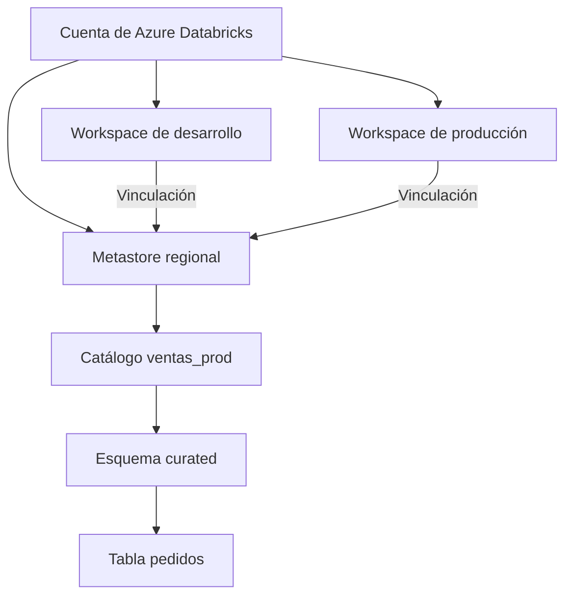
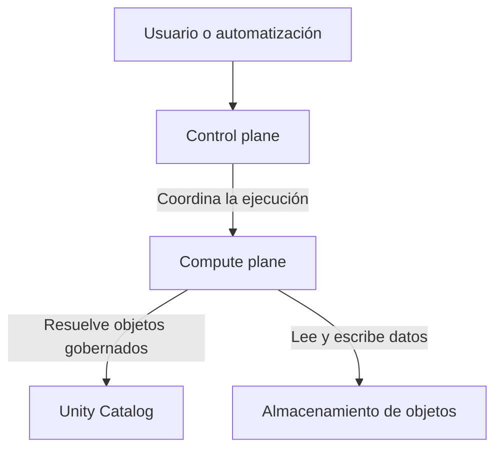
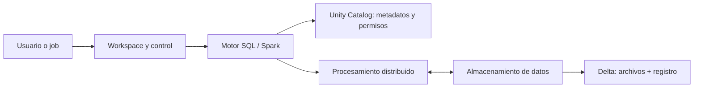

# 01 · Arquitectura de Azure Databricks

[Índice DP-750](../README.md) · [Integraciones de Azure Databricks →](../02-integraciones/README.md)

**Progreso personal:** Estudiado. [Módulo oficial](https://learn.microsoft.com/en-us/training/modules/understand-azure-databricks-architecture/).

## Unidades

1. [Introduction](#unidad-01)
2. [Understand Azure Databricks architecture](#unidad-02)
3. [Understand Unity Catalog managed storage](#unidad-03)
4. [Understand external storage](#unidad-04)
5. [Understand default storage](#unidad-05)
6. [Module assessment](#unidad-06)
7. [Summary](#unidad-07)

- [Desarrollo aplicado](#desarrollo-aplicado)
- [Laboratorio y comprobaciones](#laboratorio-y-comprobaciones)

## Unidad 01

### Introduction

Azure Databricks es una plataforma de análisis e ingeniería de datos que combina la ejecución distribuida (principalmente Apache Spark), herramientas colaborativas y un sistema centralizado de gobierno de datos. La arquitectura distingue **quién administra el servicio**, **dónde se ejecuta el trabajo** y **quién administra los datos almacenados**. Confundir estas capas produce errores habituales: creer que un workspace equivale a un metastore, asumir que el control plane procesa datos o pensar que una tabla externa borra sus archivos cuando se elimina el registro.

Una organización puede disponer de varios espacios de trabajo para desarrollo, pruebas y producción, pero utilizar un mismo sistema de gobierno de metadatos. Así se conservan políticas homogéneas mientras se separan los equipos y los recursos de ejecución.

[Unidad oficial](https://learn.microsoft.com/en-us/training/modules/understand-azure-databricks-architecture/1-introduction)

## Unidad 02

### Understand Azure Databricks architecture

### Cuenta, región y workspace

La **cuenta de Azure Databricks** es el ámbito de administración de la organización. Agrupa workspaces y metastores, y sirve para gestionar identidades, configuración y uso. La **suscripción de Azure** es el ámbito en el que Azure administra recursos y costes. La distinción importa porque el recurso de workspace se administra desde Azure, mientras que Databricks tiene su propia jerarquía de permisos, configuración e identidades. Ser propietario de un grupo de recursos de Azure y tener `SELECT` sobre un objeto de Unity Catalog son autorizaciones de sistemas distintos.

El **workspace** es el entorno donde se trabaja con notebooks, jobs, consultas y cómputo. Una organización puede separar desarrollo y producción en dos workspaces. Esa separación permite administrar quién ejecuta cargas en cada entorno y aplicar políticas de cómputo diferenciadas. El acceso a datos sigue dependiendo de la configuración de Unity Catalog. Si un catálogo requiere aislamiento por entorno, revisa tanto los privilegios de los principales como los *workspace bindings* del catálogo cuando proceda.

El **metastore** de Unity Catalog mantiene objetos de gobierno y sus metadatos. Varios workspaces de una misma región pueden estar vinculados al mismo metastore. Así pueden resolver objetos de un mismo espacio de nombres y gobernarlos de forma centralizada. El nombre de tres partes `ventas_prod.curated.pedidos` representa un catálogo, un esquema y una tabla. El nombre lógico permite localizar y autorizar el objeto aunque sus archivos físicos estén en almacenamiento de objetos. El catálogo proporciona una frontera organizativa que puede representar un dominio, entorno o unidad de negocio. El esquema subdivide ese espacio para agrupar objetos relacionados.



El diagrama representa los vínculos administrativos. La cuenta administra los workspaces y el metastore. El metastore contiene la jerarquía de objetos y el acceso desde cada workspace está sujeto a los controles aplicables.

El **Hive metastore heredado** se gestiona a nivel de workspace. En los entornos que lo exponen junto a Unity Catalog, puedes reconocer su namespace con `hive_metastore.esquema.tabla`. Este prefijo identifica el registro heredado. Antes de migrar una carga, inventaría referencias a ese prefijo y comprueba cómo se trasladarán los permisos y las ubicaciones de las tablas. Cambiar el nombre de tres partes en un notebook solo tiene sentido cuando el objeto de destino ya existe y la identidad de la carga puede utilizarlo.

### Control plane y compute plane

El **control plane** proporciona la aplicación web y los servicios backend administrados por Azure Databricks. Cuando una persona abre el workspace, programa un job o solicita iniciar cómputo, interactúa con capacidades de esta capa. El **compute plane** ejecuta el procesamiento. Cuando se lanza una consulta sobre Delta, el motor que corre en ese plano planifica el trabajo, lee los archivos que necesita y procesa las filas.

Puedes razonar sobre una operación concreta siguiendo su recorrido. Un ingeniero configura un job nocturno que transforma pedidos. La configuración del job, el disparo de la ejecución y su seguimiento pertenecen al plano de control. El procesamiento de los pedidos ocurre en el plano de cómputo. Unity Catalog resuelve los objetos gobernados y aplica los controles de acceso correspondientes. La tabla resultante permanece en su almacenamiento después de que termine el procesamiento. En una carga Spark, las unidades de trabajo se ejecutan mediante el cómputo que presta servicio a esa carga. Para diagnosticar lentitud interesa mirar la ejecución y sus métricas. Para diagnosticar por qué el job carece de una ejecución programada interesa revisar el trigger, la configuración y el historial del job.



El diagrama muestra responsabilidades y relaciones lógicas. La documentación de red determina los endpoints, rutas y detalles de cada despliegue.

### Classic compute y serverless compute

| Decisión | Classic compute | Serverless compute |
|---|---|---|
| Dónde se ejecuta | En la suscripción de Azure del cliente, en el classic compute plane | En el serverless compute plane administrado por Azure Databricks |
| Infraestructura | Configuras las opciones disponibles para ese recurso, como tipos de nodo y políticas | Databricks gestiona el aprovisionamiento de la infraestructura |
| Conectividad | Depende de la red del classic compute plane y su configuración | Usa mecanismos y requisitos de conectividad propios de serverless |
| Selección | Cuando la carga o su conectividad requiere capacidades disponibles con classic | Cuando la carga, región y requisitos de conectividad son compatibles con serverless |
| Qué comprobar en costes | Consumo de Databricks y recursos de infraestructura de Azure aplicables | Consumo de la SKU serverless correspondiente y cargos de almacenamiento o red aplicables |

Distingue **tipo de workspace** y **tipo de cómputo**. Azure puede presentar el workspace clásico como **Hybrid** en el portal. Ver un notebook conectado a Serverless identifica el tipo de cómputo de esa sesión. Para identificar el tipo de workspace, consulta el recurso y su configuración. Evita deducir la propiedad de la cuenta de almacenamiento a partir del selector de cómputo.

**Ejemplo de diseño.** Un equipo ejecuta una consulta sobre una tabla cuyos datos están en una cuenta de Azure Storage con acceso restringido. Cambiar el notebook de classic a serverless cambia el origen de la conexión a almacenamiento y puede requerir revisar la conectividad autorizada. El nombre de la tabla y los permisos en Unity Catalog pueden seguir siendo los mismos. La puesta en marcha exige verificar por separado la identidad de ejecución, las autorizaciones sobre el objeto y la ruta efectiva a Storage. Si solo falla serverless, compara primero los requisitos de red y las capacidades de cómputo aplicables, utilizando el mensaje de error como evidencia.

### Metadatos, almacenamiento del workspace y datos del negocio

Los archivos del workspace contienen artefactos de trabajo, como notebooks y código. Azure Databricks también persiste datos internos, como resultados de ejecución y revisiones, según la arquitectura del workspace. Los datos que el equipo gobierna para análisis y producción aparecen como tablas y volúmenes en Unity Catalog. Una **tabla** expone datos tabulares y un **volumen** permite organizar y acceder a archivos gobernados. Un notebook versionado en Git puede leer una tabla, producir un resultado de ejecución y escribir otra tabla. El artefacto de código, el resultado operativo y el dato de negocio cumplen funciones distintas y requieren sus propias políticas.

En un workspace clásico, el workspace storage account forma parte de los recursos en la suscripción del cliente. Un workspace serverless utiliza *default storage* para sus necesidades de almacenamiento gestionado y permite conectar almacenamiento cloud compatible. Una tabla *managed* delega en Unity Catalog el ciclo de vida del objeto y sus archivos. Una tabla *external* registra una ubicación cuyo ciclo de vida de archivos gestiona el propietario del almacenamiento. Ambas pueden estar gobernadas en Unity Catalog. Las unidades siguientes del módulo desarrollan estos tipos de almacenamiento y sus mecanismos de acceso.

En un workspace clásico habilitado automáticamente para Unity Catalog, el almacenamiento del catálogo de workspace por defecto puede residir en la cuenta de almacenamiento del workspace. También puedes encontrar `DBFS root` y mounts en entornos heredados. Para ubicar un dataset, distingue entre una ruta de esos mecanismos heredados y un volumen de Unity Catalog, que se navega bajo `/Volumes/catalogo/esquema/volumen`. Los datos internos del workspace requieren conservar su cuenta de almacenamiento. La limpieza de una práctica se aplica al cómputo o al entorno dedicado completo, según el caso.

### Diagnóstico de una consulta

Supón que un job en producción falla con una consulta sobre `ventas_prod.curated.pedidos`. El usuario interactivo que creó el job puede consultar la tabla en el notebook. La identidad que ejecuta el job puede ser un service principal distinto.

1. Comprueba en la ejecución del job el **Run as** y el workspace desde el que se ejecutó. Así sabes qué principal y contexto debes investigar.
2. Confirma el vínculo del workspace al metastore y los bindings configurados en el catálogo. La visibilidad de la tabla depende del entorno y de los controles aplicables.
3. Para lectura, revisa los privilegios efectivos del principal, incluidos `USE CATALOG`, `USE SCHEMA` y `SELECT`, y comprueba si llegan a través de grupos o privilegios heredados.
4. Si la resolución y autorización funcionan pero falla la lectura de archivos, revisa la conectividad del compute plane a Storage y la configuración de acceso a la ubicación. Un error de red y una denegación de Unity Catalog suelen enviarte a responsables distintos.
5. Si la consulta se ejecuta lentamente, inspecciona el plan y las métricas de ejecución. La identidad, el namespace y la conexión pueden funcionar correctamente aunque el plan lea una cantidad alta de datos.

El **control plane** mantiene la experiencia web, configuraciones, planificación y coordinación de trabajos. No es el lugar principal donde se ejecutan las transformaciones del usuario. El **compute plane** aloja el procesamiento de consultas, Spark y las cargas analíticas.

| Aspecto | Control plane | Compute plane |
|---|---|---|
| Función | Gestión y orquestación | Procesamiento de datos |
| Elementos | UI, APIs de gestión, programación | Motores, workers, recursos de ejecución |
| Preocupación principal | Administración de la plataforma | Rendimiento, aislamiento y costes |

En **classic compute**, los recursos de proceso se despliegan en la suscripción Azure del cliente, con mayores opciones de diseño de red. En **serverless compute**, Databricks administra la infraestructura de cómputo y sus escalados; no significa ausencia de costes, ni disponibilidad universal para todos los casos de uso. La elección depende del soporte de cargas, red, bibliotecas y controles requeridos.

[Unidad oficial](https://learn.microsoft.com/en-us/training/modules/understand-azure-databricks-architecture/2-understand-azure-databricks-architecture)

## Unidad 03

### Understand Unity Catalog managed storage

Una tabla **managed** delega a Unity Catalog la administración del ciclo de vida físico de sus archivos. Una tabla **external** registra los archivos donde ya están, pero su ciclo de vida lo conserva el propietario externo. Un **volumen** ofrece un mecanismo gobernado para archivos no tabulares (documentos, audio, imágenes, archivos de llegada). La tabla representa datos estructurados interpretados por un motor de consultas.

Las ubicaciones de almacenamiento administrado pueden establecerse en distintos niveles: **schema → catalog → metastore** (orden de resolución: gana la ubicación más específica). Para aislar desarrollo y producción resulta práctico asignar una raíz diferente a cada catálogo. Unity Catalog genera sus propios subdirectorios internos únicos: no conviene reconstruir a mano rutas privadas ni modificar archivos gestionados directamente.

**Ejemplo conceptual:** si `catalogo_prod` tiene una ubicación en un contenedor productivo y su esquema `sensibles` usa otra ubicación, las tablas managed de `sensibles` se almacenan bajo la segunda. Las tablas de los demás esquemas pueden heredar la del catálogo.

#### Elección de la raíz y límites operativos

La raíz administrada establece dónde se crearán nuevos objetos managed. Considera un catálogo con una raíz compartida para todo un dominio y un esquema para información sensible que declara una raíz distinta. La configuración más específica se aplica a los nuevos objetos de ese esquema. Cambiar la configuración de la raíz no constituye una migración de archivos. Para trasladar activos existentes hay que planificar la copia o reconstrucción de las tablas, comprobar permisos y dependencias, y validar el cambio antes de retirar el origen. Evita dar acceso directo a los directorios internos de las tablas managed, ya que se perdería la mediación de Unity Catalog.

Para autorizar una raíz en ADLS, el administrador configura una external location y concede `CREATE MANAGED STORAGE` a quien vaya a utilizarla con este fin. Verifica que puedes administrar el catálogo o esquema correspondiente y que tienes los privilegios de creación requeridos. Concede estos permisos al equipo que prepara el namespace. Un consumidor que solo tiene que consultar una tabla recibe acceso al catálogo, al esquema y al objeto sin necesidad de administrar el almacenamiento.

```sql
CREATE SCHEMA IF NOT EXISTS ventas_prod.sensible
MANAGED LOCATION 'abfss://datos@cuentaprod.dfs.core.windows.net/managed/sensible';
```

La ruta es ilustrativa y debe quedar cubierta por una external location válida. Usa una ubicación dedicada. Separa rutas administradas de rutas ya registradas para otros objetos y evita solapamientos que impidan registrar tablas o volúmenes.

[Unidad oficial](https://learn.microsoft.com/en-us/training/modules/understand-azure-databricks-architecture/3-understand-unity-catalog-managed-storage)

## Unidad 04

### Understand external storage

Una **storage credential** representa el medio autorizado para acceder al almacenamiento Azure. Una **external location** combina esa credencial con una ruta física autorizada. Unity Catalog puede aplicar privilegios y limitar desde qué workspaces se utiliza la ubicación. En Azure normalmente se emplea ADLS Gen2 y, cuando es viable, identidades administradas para reducir el uso de secretos.

```text
Identidad administrada / principal de servicio
               ↓
       Storage credential
               +
       Ruta abfss://...
               ↓
       External location
               ↓
  Tablas externas / volúmenes / raíces managed
```

**Importante:** no es lo mismo asignar una *external location* para crear una tabla externa que utilizarla como punto de partida para almacenar una tabla managed. En el primer caso se conserva la administración externa de los archivos; en el segundo Unity Catalog gestiona su ciclo de vida.

#### Recorrido de una lectura externa

Imagina que un equipo publica ficheros Parquet desde otra aplicación y Databricks los consulta en ADLS. El Access Connector puede aportar una managed identity para que Azure autorice las operaciones sobre el contenedor. Unity Catalog registra esa identidad mediante una storage credential y la vincula a una ruta con una external location. Un administrador puede registrar una tabla externa sobre un subdirectorio cubierto por esa ubicación. El analista consulta la tabla por nombre y recibe permisos sobre el objeto. Concederle también acceso directo al contenedor ampliaría el ámbito de lo que puede leer por fuera de ese objeto.

Si el registro falla con un mensaje de solapamiento, inventaría tablas, volúmenes y raíces managed existentes. Si falla con autorización, revisa el privilegio de Unity Catalog y los permisos de Azure de la identidad de almacenamiento. Si falla tras cambiar de compute, comprueba conectividad y DNS desde el compute plane utilizado. Son comprobaciones independientes y conviene conservar el mensaje exacto antes de cambiar la configuración.

[Unidad oficial](https://learn.microsoft.com/en-us/training/modules/understand-azure-databricks-architecture/4-understand-external-storage)

## Unidad 05

### Understand default storage

El almacenamiento del workspace contiene elementos de usuario (notebooks, consultas, configuraciones) y datos internos del sistema (resultados, registros, revisiones). Los espacios de trabajo clásicos pueden tener una cuenta de almacenamiento asociada a su suscripción. Los espacios serverless pueden disponer de almacenamiento predeterminado completamente administrado por la plataforma.

**DBFS root y los mounts heredados no deben ser la elección por defecto para nuevos datos gobernados**: para tablas, usar Unity Catalog; para ficheros no tabulares, volúmenes. Una ruta `dbfs:/` del legado y una ruta `/Volumes/catalogo/esquema/volumen/...` tienen modelos de gobierno diferentes.

#### Qué observar en el workspace

Un equipo de formación puede usar almacenamiento por defecto para crear objetos managed con poca preparación. En un proyecto empresarial, puede requerirse una cuenta ADLS específica por sensibilidad, residencia o administración del ciclo de vida. En ese caso documenta qué objetos van a una raíz propia y qué artefactos quedan en el almacenamiento del workspace. El nombre de un catálogo en Catalog Explorer por sí solo no acredita que sus archivos estén en una cuenta Azure propiedad de la organización. Comprueba la configuración del workspace y el detalle del objeto con el rol adecuado. Contrasta también límites, compatibilidad y disponibilidad de default storage en la región elegida.

[Unidad oficial](https://learn.microsoft.com/en-us/training/modules/understand-azure-databricks-architecture/5-understand-default-storage)

## Unidad 06

### Module assessment

- ¿Qué componente conoce las tablas y sus privilegios? **El metastore y Unity Catalog**.
- ¿Dónde se ejecuta normalmente una tarea de Spark? **En el compute plane**.
- ¿Qué ubicación tiene preferencia cuando schema y catálogo declaran almacenamiento managed? **La del esquema**.
- ¿Qué ocurre al eliminar una tabla externa? **Se elimina la definición gobernada; los datos externos no se eliminan automáticamente por ese DROP**.
- ¿Es una external location una credencial? **No; referencia una credencial y una ruta**.

> **Práctica de consolidación:** dibuja la cuenta, dos workspaces, un metastore, dos catálogos y un ADLS Gen2, y anota quién administra cada pieza.

[Unidad oficial](https://learn.microsoft.com/en-us/training/modules/understand-azure-databricks-architecture/6-knowledge-check)

## Unidad 07

### Summary

El diseño se comprueba con tres preguntas. ¿Quién controla la identidad y los objetos? ¿Dónde se ejecuta la carga? ¿Quién administra el ciclo de vida de sus archivos? Dos workspaces pueden compartir metastore regional aunque sus recursos de ejecución sean distintos. Una tabla managed puede vivir en almacenamiento de la organización. La clasificación managed describe el control que ejerce Unity Catalog sobre el objeto y sus archivos. Usa estos criterios para decidir si un incidente requiere al administrador de Azure, al administrador de Databricks o al propietario del catálogo.

[Unidad oficial](https://learn.microsoft.com/en-us/training/modules/understand-azure-databricks-architecture/7-summary)

## Desarrollo aplicado

### Plano de control y plano de datos

La arquitectura separa las responsabilidades de administración y coordinación de las de ejecución. El **control plane** aloja servicios de gestión del workspace, coordinación de trabajos, metadatos operativos y funciones de interfaz. El **compute plane** ejecuta los procesos necesarios para notebooks, Spark y SQL según la modalidad elegida. La distribución exacta de servicios y el aislamiento de red dependen de la modalidad de implementación y de la configuración de Azure Databricks, de modo que no conviene dibujar una arquitectura universal válida para todos los workspaces.

El almacenamiento duradero está desacoplado de los nodos de ejecución. Los datos pueden residir en Azure Data Lake Storage y estar expuestos mediante objetos gobernados por Unity Catalog. Delta Lake añade una capa transaccional sobre archivos de datos: Spark no se limita a leer una carpeta Parquet, sino que considera el estado coherente definido en el registro de transacciones de la tabla.

### Recorrido de `SELECT` y de un trabajo Spark

Cuando un usuario ejecuta una consulta, se comprueba que su identidad pueda usar los objetos y el cómputo correspondiente. El motor analiza la consulta, resuelve los metadatos, optimiza el plan y envía trabajo a los recursos disponibles. En Spark, los pasos que requieren reordenar datos por claves (joins o agregaciones distribuidas) suelen implicar un *shuffle*. Un shuffle obliga a mover datos entre particiones, consume red y puede escribir temporalmente a disco si no hay memoria suficiente. Por eso una consulta aparentemente pequeña puede ser costosa si produce una unión con mucha cardinalidad.



El diagrama muestra relaciones lógicas, no la ubicación física exacta de cada servicio. Al diagnosticar un problema debes identificar si es de autenticación, autorización, capacidad de ejecución, planificación Spark, acceso al almacenamiento o consistencia de los datos.

### Driver, executors, particiones y tareas

El driver mantiene el contexto de la aplicación y coordina la ejecución. Los executors procesan particiones; cada tarea suele operar sobre una partición en una etapa. El número de archivos, el tamaño de los datos, la distribución de claves y las operaciones del plan afectan al paralelismo real. Tener más nodos no elimina un cuello de botella causado por una sola partición excesivamente grande. A la inversa, una consulta sencilla puede no aprovechar todos los cores que se han provisionado.

**Ejemplo de sesgo:** si el 90 % de las ventas pertenece a un único cliente, una agregación por cliente concentra mucho trabajo en la partición de esa clave. El problema no se resuelve necesariamente ampliando el clúster; conviene analizar distribuciones, plan de ejecución y alternativas como preagregación o salting cuando sea apropiado.

### Red, seguridad y decisiones de diseño

El acceso a ADLS requiere una identidad y permisos sobre los recursos correctos. Un usuario que ve una tabla en el catálogo no necesariamente puede administrarla. La gestión de credenciales debe evitar secretos incrustados en notebooks y priorizar identidades administradas y mecanismos de acceso gobernados. Para entornos empresariales, considera conectividad privada, controles de salida, DNS, restricciones de red y políticas de cómputo de acuerdo con la arquitectura admitida.

**Laboratorio de diagnóstico:** explica cuál de estas capas revisarías cuando (a) no puedes entrar al workspace, (b) sí puedes entrar pero no iniciar un clúster, (c) el clúster ejecuta Python pero devuelve `PERMISSION_DENIED` en una tabla, (d) una unión de tablas tarda mucho mientras el número de filas de salida es pequeño. Para (c) empieza por permisos y contexto de catálogo; para (d), por el plan y Spark UI, antes de aumentar recursos indiscriminadamente.

## Laboratorio y comprobaciones

### Asociación y objetivo

Microsoft Learn publica siete unidades para Arquitectura y su índice no incluye un laboratorio propio. Esta práctica complementaria utiliza el entorno del **Lab 0** oficial o un workspace existente. Está relacionada con el **Lab 1, Explore Azure Databricks**, que se aprovecha para reconocer la interfaz y el papel de un volumen. La práctica propone observaciones y valores esperados. Su ejecución en Azure queda pendiente.

### Requisitos

Necesitas acceso a un workspace con Unity Catalog, permiso para usar el cómputo elegido y, para la comprobación opcional de datos, acceso de lectura a una tabla de prácticas conocida. Si el workspace ya existe, la práctica se puede hacer con recursos autorizados existentes. Si necesitas aprovisionarlo, sigue el Lab 0 y utiliza un grupo de recursos dedicado a las prácticas. Los permisos para crear recursos en Azure y el permiso para ejecutar cómputo en el workspace se comprueban en sus respectivos ámbitos.

### Procedimiento y verificaciones

1. **Identifica el workspace en Azure.** En el portal, abre el recurso Azure Databricks y anota región, suscripción y grupo de recursos. Si tu rol te permite ver su configuración, registra el tipo de workspace. Abre el workspace desde el recurso y confirma que estás trabajando en ese entorno.
2. **Identifica el compute plane.** Abre un notebook SQL de prácticas y el selector de cómputo. Si la sesión usa Serverless, anota *serverless compute plane*. Si usa un clúster clásico, anota *classic compute plane*. El tipo de cómputo pertenece a esta ejecución. Si solo dispones de uno, registra el observado.
3. **Comprueba el contexto de la sesión.** Ejecuta el primer bloque. `current_user()` permite identificar a quién se evalúa en esa sesión. El catálogo y esquema actuales son los que se usan para resolver nombres sin calificar. Los resultados concretos dependen de tu sesión.
4. **Sigue un objeto hasta su metadata.** En Catalog Explorer, identifica una tabla de tu entorno de prácticas. Anota catálogo, esquema y tabla. Si cuentas con autorización, cambia `mi_catalogo.mi_esquema.mi_tabla` en el segundo bloque y consulta su metadata. El resultado esperado incluye datos de la tabla. Los campos visibles dependen del objeto y los privilegios.
5. **Comprueba el acceso a las filas.** Ejecuta el último `SELECT` contra la tabla de prácticas. Una respuesta correcta confirma que esa identidad y ese tipo de cómputo han podido leer ese objeto en ese workspace. Cero filas es un resultado válido si la tabla está vacía. `LIMIT 5` limita el resultado devuelto. El coste y el trabajo de lectura dependen del plan y la tabla.
6. **Anota una evidencia por capa.** Guarda la región del recurso, el tipo de cómputo seleccionado, la identidad devuelta y el nombre de tres partes. Si tienes dos workspaces autorizados en la misma región, puedes comparar el catálogo visible desde ambos y preguntar al administrador por el metastore asignado y los bindings. La coincidencia de nombres por sí sola no demuestra que compartan metastore.

```sql
SELECT current_user() AS identidad,
       current_catalog() AS catalogo,
       current_schema() AS esquema;

SHOW CATALOGS;
```

```sql
DESCRIBE TABLE EXTENDED mi_catalogo.mi_esquema.mi_tabla;

SELECT *
FROM mi_catalogo.mi_esquema.mi_tabla
LIMIT 5;
```

| Observación | Comprobación siguiente |
|---|---|
| El notebook no tiene cómputo disponible | Revisa permisos de uso del recurso, disponibilidad del tipo de cómputo y políticas del workspace. |
| El catálogo no aparece en `SHOW CATALOGS` | Pide que comprueben visibilidad, permisos y vínculos. Esa salida refleja lo que la identidad puede ver. |
| La tabla se resuelve y la lectura falla | Revisa el mensaje para distinguir autorización sobre tablas de conectividad o autorización en el almacenamiento. |
| El notebook funciona y el job falla | Compara identidad Run as, workspace y configuración de cómputo del job con la sesión interactiva. |

### Limpieza y costes

Si iniciaste cómputo clásico dedicado y tienes permiso para administrarlo, detenlo al acabar. Si trabajaste con recursos compartidos, revisa su política de terminación automática con el responsable. El SQL de observación no crea tablas. Si el entorno se desplegó solo para el curso y ya has terminado con él, sigue el Lab 0 de limpieza y verifica que actúas sobre el grupo de recursos dedicado. Conserva cualquier ejercicio que necesites antes de retirar el entorno. Detener el cómputo y retirar recursos persistentes son operaciones distintas.

- [Lab 0 · Aprovisionamiento de Azure Databricks](https://microsoftlearning.github.io/DP-750T00-Implement-Data-Engineering-Solutions-using-Azure-Databricks/Instructions/Labs/00-setup.html)
- [Lab 1 · Explore Azure Databricks](https://microsoftlearning.github.io/DP-750T00-Implement-Data-Engineering-Solutions-using-Azure-Databricks/Instructions/Labs/01-explore-azure-databricks.html)
- [Notebook del Lab 1](https://github.com/MicrosoftLearning/DP-750T00-Implement-Data-Engineering-Solutions-using-Azure-Databricks/blob/main/Allfiles/01-explore-azure-databricks.ipynb)
- [Dataset routes.csv](https://raw.githubusercontent.com/MicrosoftLearning/DP-750T00-Implement-Data-Engineering-Solutions-using-Azure-Databricks/refs/heads/main/Allfiles/data/routes.csv)
- [Laboratorios oficiales, incluidos provisión, exploración y limpieza](https://microsoftlearning.github.io/DP-750T00-Implement-Data-Engineering-Solutions-using-Azure-Databricks/)
- [Repositorio de notebooks y material de MicrosoftLearning](https://github.com/MicrosoftLearning/DP-750T00-Implement-Data-Engineering-Solutions-using-Azure-Databricks)

## Fuentes y navegación

- [Fuentes de la certificación](../FUENTES.md)
- [Preparación y limpieza del entorno](../PREPARACION-LABORATORIOS.md)

[Índice DP-750](../README.md) · [Integraciones de Azure Databricks →](../02-integraciones/README.md)
