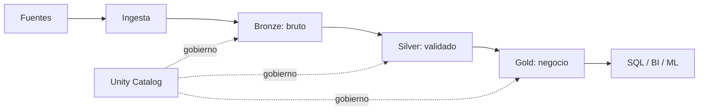

[🏠 Índice](../README.md) · [Siguiente →](../02-arquitectura-de-azure-databricks/README.md)

> **Estado de estudio:** ✅ Visto · **Unidades oficiales:** 8 · [Microsoft Learn](https://learn.microsoft.com/en-us/training/modules/explore-azure-databricks/)  
> **Versión de apuntes:** 14-11-2026 · Contenido técnico redactado de forma original a partir del itinerario de Microsoft.

# 1. Explorar Azure Databricks

**Referencia Microsoft Learn:** [Explorar Azure Databricks](https://learn.microsoft.com/en-us/training/modules/explore-azure-databricks/) · **8 unidades oficiales**.

## 1.1. ¿Qué resuelve Databricks?

En proyectos tradicionales, la ingeniería de datos, el reporting y el machine learning pueden requerir plataformas separadas y múltiples copias de los datos. El enfoque **lakehouse** intenta reunir las posibilidades de un data lake (almacenamiento flexible y escalable) con las garantías analíticas de un data warehouse (estructuración, transacciones y consultas SQL).

Una solución típica utiliza almacenamiento de objetos, tablas Delta, Spark para preparación y SQL warehouses para consumo. Unity Catalog aporta gobierno por encima de estos recursos; los notebooks y los jobs ofrecen los flujos de ejecución.

## 1.2. Obtener un workspace

Un workspace Azure Databricks se aprovisiona como recurso Azure, en una región, una suscripción y un grupo de recursos, sujeto a permisos y condiciones organizativas. Dentro del workspace se configura identidad, conectividad, cómputo y acceso al metastore. La selección de región puede influir en proximidad a los datos, latencia, residencia y coste.

**No confundir:** el recurso Azure permite crear el servicio; no es automáticamente una autorización de lectura a todas las tablas. Azure RBAC, identidades y privilegios de Unity Catalog cumplen funciones distintas.

## 1.3. Cargas de trabajo

- **Ingeniería de datos:** ingesta, validación, transformación, modelado, orquestación.
- **Análisis de datos:** SQL, métricas, dashboards, exploración.
- **Ciencia de datos / ML:** preparación de características, experimentación, entrenamiento y aplicación de modelos.
- **Streaming:** captura de eventos y cálculo incremental.

En un proceso batch, una tarea transforma datos que llegan periódicamente. En streaming, el motor mantiene un proceso incremental y un checkpoint de estado, pero el resultado no siempre es instantáneo: depende del trigger, fuente, red y recursos.

## 1.4. Conceptos fundamentales

**Apache Spark:** motor distribuido con APIs de DataFrames, SQL y procesamiento de flujos. **Notebook:** documento ejecutable que combina código, texto y salidas. **Job:** ejecución programada o desencadenada con tareas y dependencias. **Delta Lake:** formato de tabla con registro transaccional, cambios y capacidades de consulta histórica sujetas a retención. **Unity Catalog:** gobernanza de datos y activos.

La arquitectura Medallion (Bronze, Silver, Gold) es un patrón útil, **no una obligación universal**. Bronze conserva detalles de llegada; Silver mejora calidad, deduplica y estandariza; Gold produce entidades para consumo. El diseño correcto depende del caso de negocio.

## 1.5. Unity Catalog y Purview en el gobierno

Unity Catalog permite localizar objetos, otorgar permisos, descubrir linaje y aplicar políticas, mientras Purview aporta una visión más amplia del patrimonio de datos empresarial. Un catálogo bien construido necesita convenciones de nombres, propietarios y descripciones; sin esos detalles, la plataforma funciona técnicamente pero resulta difícil de descubrir y mantener.

## 1.6. Mini laboratorio y evaluación

Crear un notebook que lea un pequeño dataset, filtre filas no válidas, agrupe por categoría y guarde un resultado en una tabla de un esquema de pruebas. Identificar qué cómputo ejecutó el notebook y qué permisos permiten crear la tabla. Después consultar la tabla desde SQL.

**Preguntas:** ¿qué diferencia hay entre lakehouse y warehouse? ¿Por qué importa la transaccionalidad de Delta? ¿Una tabla de Unity Catalog es el mismo objeto que un notebook? ¿En qué capa aplicarías limpieza de datos?

---

---

## 🧪 Guía de laboratorio y comprobación práctica

**Ejercicio oficial:** [Abrir las instrucciones de MicrosoftLearning](https://microsoftlearning.github.io/DP-750T00-Implement-Data-Engineering-Solutions-using-Azure-Databricks/Instructions/Labs/01-explore-azure-databricks.html)  
**Notebook oficial:** [Importar o consultar notebook `.ipynb`](https://raw.githubusercontent.com/MicrosoftLearning/DP-750T00-Implement-Data-Engineering-Solutions-using-Azure-Databricks/refs/heads/main/Allfiles/01-explore-azure-databricks.ipynb)  
**Naturaleza de esta sección:** itinerario explicado con redacción propia y comprobaciones de aprendizaje. Las celdas exactas y el material de origen están en el notebook oficial enlazado; no se reproducen íntegramente aquí.

### Caso práctico: CityMoves Transit — primeros pasos en el workspace

**Finalidad:** conocer la interfaz real del workspace, trabajar con archivos en volúmenes de Unity Catalog y familiarizarse con notebooks de Python, SQL y Markdown. En el recurso original, los ejercicios continúan dentro de un notebook proporcionado por Microsoft.

**Preparación y permisos.** Es necesario disponer de un workspace Premium y acceso al catálogo de práctica. La guía oficial de aprovisionamiento utiliza el workspace `adb-dp750`. Si trabajas en tu propio workspace, ajusta los nombres; crear recursos puede generar costes.

**Secuencia recomendada de ejecución:**

1. Accede al workspace y localiza las áreas **Workspace**, **Catalog**, **Compute**, **Jobs & Pipelines** y la búsqueda de activos. En **New**, observa qué tipos de recursos puedes crear y qué diferencias hay entre un notebook, una consulta y un job.
2. Revisa el asistente integrado, si está disponible: su objetivo es ayudar a escribir y comprender código, no sustituir la comprobación del resultado. En un contexto de examen, no presupongas que estará permitido utilizarlo.
3. Abre **Catalog Explorer**; bajo el catálogo de prácticas y el esquema `default`, crea un volumen **managed** llamado `lab_data`. Comprueba el nombre cualificado y la ruta `/Volumes/<catalogo>/default/lab_data/`.
4. Utiliza la interfaz de carga de datos para depositar un CSV de líneas o rutas de transporte en dicho volumen. Antes de transformarlo, verifica que el archivo aparezca en el explorador del volumen. El material oficial ofrece `routes.csv` en su repositorio.
5. Importa el notebook oficial **desde URL** en una carpeta de Workspace, abre el archivo y selecciona un cómputo compatible (la práctica oficial propone Serverless).
6. Recorre las celdas: ejecuta Python básico, cambia el lenguaje mediante `%sql` donde proceda y añade comentarios en Markdown. Examina cómo se muestran resultados tabulares y cómo quedan almacenadas las definiciones de las celdas.

**Verificaciones de aprendizaje:** distingue *subir un archivo a un volumen* de *crear una tabla Delta*; confirma que no es necesario crear una tabla para visualizar el CSV en el volumen; explica qué trabajo realiza el cómputo y qué registra Unity Catalog.

**Evidencias sugeridas:** captura del volumen con el CSV, notebook con celdas Python/SQL/Markdown y selector de cómputo.

---

### 📚 Fuentes y navegación

- [Contenido oficial de Microsoft Learn](https://learn.microsoft.com/en-us/training/modules/explore-azure-databricks/)
- [Repositorio docente de laboratorios DP-750T00](https://microsoftlearning.github.io/DP-750T00-Implement-Data-Engineering-Solutions-using-Azure-Databricks/)
- [Guía oficial de competencias del examen DP-750](https://learn.microsoft.com/en-us/credentials/certifications/resources/study-guides/dp-750)

[🏠 Índice](../README.md) · [Siguiente →](../02-arquitectura-de-azure-databricks/README.md)
