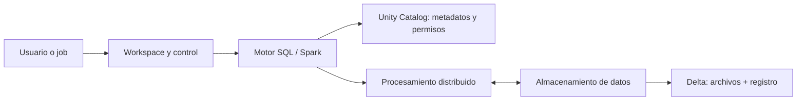

[🏠 Índice](../README.md) · [← Anterior](../01-explorar-azure-databricks/README.md) · [Siguiente →](../03-integraciones-de-azure-databricks/README.md)

> **Estado de estudio:** ✅ Visto · **Unidades oficiales:** 7 · [Microsoft Learn](https://learn.microsoft.com/en-us/training/modules/understand-azure-databricks-architecture/)  
> **Versión de apuntes:** 15-11-2026 · Contenido técnico redactado de forma original a partir del itinerario de Microsoft.

# 2. Arquitectura de Azure Databricks

**Referencia Microsoft Learn:** [Arquitectura de Azure Databricks](https://learn.microsoft.com/en-us/training/modules/understand-azure-databricks-architecture/) · **7 unidades oficiales**.

## 2.1. Introducción y visión de conjunto

Azure Databricks es una plataforma de análisis e ingeniería de datos que combina la ejecución distribuida (principalmente Apache Spark), herramientas colaborativas y un sistema centralizado de gobierno de datos. La arquitectura distingue **quién administra el servicio**, **dónde se ejecuta el trabajo** y **quién administra los datos almacenados**. Confundir estas capas produce errores habituales: creer que un workspace equivale a un metastore, asumir que el control plane procesa datos o pensar que una tabla externa borra sus archivos cuando se elimina el registro.

Una organización puede disponer de varios espacios de trabajo para desarrollo, pruebas y producción, pero utilizar un mismo sistema de gobierno de metadatos. Así se conservan políticas homogéneas mientras se separan los equipos y los recursos de ejecución.

## 2.2. Jerarquía de cuenta, workspace y Unity Catalog

- **Cuenta Databricks:** ámbito global de administración, identidad, workspaces y supervisión.
- **Workspace:** entorno colaborativo con notebooks, consultas, trabajos, recursos de cómputo y configuraciones de su equipo.
- **Metastore de Unity Catalog:** repositorio de metadatos y permisos, asociado a una región; permite gobernar activos compartidos entre los workspaces conectados.
- **Catálogo:** agrupador de alto nivel que suele representar un dominio, un entorno o una sensibilidad.
- **Esquema (database):** agrupador intermedio de conjuntos de datos relacionados.
- **Objeto:** tabla, vista, volumen, función u otro recurso registrado.

Un identificador típico tiene tres niveles: `catalogo.esquema.tabla`, por ejemplo `produccion.ventas.pedidos`. El antiguo `hive_metastore` mantiene el esquema de metadatos legado a nivel de workspace; para soluciones nuevas y gobierno consistente se prefiere Unity Catalog.

```text
Cuenta Azure Databricks
├── Workspace desarrollo ─────┐
├── Workspace producción ─────┤ comparten gobierno si usan el mismo metastore
└── Metastore Unity Catalog ──┘
    ├── catalogo_desarrollo
    │   └── ventas
    │       └── pedidos
    └── catalogo_produccion
        └── ventas
            ├── pedidos
            └── clientes
```

## 2.3. Control plane frente a compute plane

El **control plane** mantiene la experiencia web, configuraciones, planificación y coordinación de trabajos. No es el lugar principal donde se ejecutan las transformaciones del usuario. El **compute plane** aloja el procesamiento de consultas, Spark y las cargas analíticas.

| Aspecto | Control plane | Compute plane |
|---|---|---|
| Función | Gestión y orquestación | Procesamiento de datos |
| Elementos | UI, APIs de gestión, programación | Motores, workers, recursos de ejecución |
| Preocupación principal | Administración de la plataforma | Rendimiento, aislamiento y costes |

En **classic compute**, los recursos de proceso se despliegan en la suscripción Azure del cliente, con mayores opciones de diseño de red. En **serverless compute**, Databricks administra la infraestructura de cómputo y sus escalados; no significa ausencia de costes, ni disponibilidad universal para todos los casos de uso. La elección depende del soporte de cargas, red, bibliotecas y controles requeridos.

## 2.4. Almacenamiento administrado por Unity Catalog

Una tabla **managed** delega a Unity Catalog la administración del ciclo de vida físico de sus archivos. Una tabla **external** registra los archivos donde ya están, pero su ciclo de vida lo conserva el propietario externo. Un **volumen** ofrece un mecanismo gobernado para archivos no tabulares (documentos, audio, imágenes, archivos de llegada). La tabla representa datos estructurados interpretados por un motor de consultas.

Las ubicaciones de almacenamiento administrado pueden establecerse en distintos niveles: **schema → catalog → metastore** (orden de resolución: gana la ubicación más específica). Para aislar desarrollo y producción resulta práctico asignar una raíz diferente a cada catálogo. Unity Catalog genera sus propios subdirectorios internos únicos: no conviene reconstruir a mano rutas privadas ni modificar archivos gestionados directamente.

**Ejemplo conceptual:** si `catalogo_prod` tiene una ubicación en un contenedor productivo y su esquema `sensibles` usa otra ubicación, las tablas managed de `sensibles` se almacenan bajo la segunda. Las tablas de los demás esquemas pueden heredar la del catálogo.

## 2.5. Almacenamiento externo, credenciales y external locations

Una **storage credential** representa el medio autorizado para acceder al almacenamiento Azure. Una **external location** combina esa credencial con una ruta física autorizada. Unity Catalog puede aplicar privilegios y limitar desde qué workspaces se utiliza la ubicación. En Azure normalmente se emplea ADLS Gen2 y, cuando es viable, identidades administradas para reducir el uso de secretos.

```text
Identidad administrada / principal de servicio
               ↓
       Storage credential
               +
       Ruta abfss://...
               ↓
       External location
               ↓
  Tablas externas / volúmenes / raíces managed
```

**Importante:** no es lo mismo asignar una *external location* para crear una tabla externa que utilizarla como punto de partida para almacenar una tabla managed. En el primer caso se conserva la administración externa de los archivos; en el segundo Unity Catalog gestiona su ciclo de vida.

## 2.6. Almacenamiento predeterminado y workspace storage

El almacenamiento del workspace contiene elementos de usuario (notebooks, consultas, configuraciones) y datos internos del sistema (resultados, registros, revisiones). Los espacios de trabajo clásicos pueden tener una cuenta de almacenamiento asociada a su suscripción. Los espacios serverless pueden disponer de almacenamiento predeterminado completamente administrado por la plataforma.

**DBFS root y los mounts heredados no deben ser la elección por defecto para nuevos datos gobernados**: para tablas, usar Unity Catalog; para ficheros no tabulares, volúmenes. Una ruta `dbfs:/` del legado y una ruta `/Volumes/catalogo/esquema/volumen/...` tienen modelos de gobierno diferentes.

## 2.7. Autoevaluación y recapitulación

- ¿Qué componente conoce las tablas y sus privilegios? **El metastore y Unity Catalog**.
- ¿Dónde se ejecuta normalmente una tarea de Spark? **En el compute plane**.
- ¿Qué ubicación tiene preferencia cuando schema y catálogo declaran almacenamiento managed? **La del esquema**.
- ¿Qué ocurre al eliminar una tabla externa? **Se elimina la definición gobernada; los datos externos no se eliminan automáticamente por ese DROP**.
- ¿Es una external location una credencial? **No; referencia una credencial y una ruta**.

> **Práctica de consolidación:** dibuja la cuenta, dos workspaces, un metastore, dos catálogos y un ADLS Gen2, y anota quién administra cada pieza.

---

---


## Desarrollo en profundidad: arquitectura y recorrido de una consulta

### Plano de control y plano de datos

La arquitectura separa las responsabilidades de administración y coordinación de las de ejecución. El **control plane** aloja servicios de gestión del workspace, coordinación de trabajos, metadatos operativos y funciones de interfaz. El **compute plane** ejecuta los procesos necesarios para notebooks, Spark y SQL según la modalidad elegida. La distribución exacta de servicios y el aislamiento de red dependen de la modalidad de implementación y de la configuración de Azure Databricks, de modo que no conviene dibujar una arquitectura universal válida para todos los workspaces.

El almacenamiento duradero está desacoplado de los nodos de ejecución. Los datos pueden residir en Azure Data Lake Storage y estar expuestos mediante objetos gobernados por Unity Catalog. Delta Lake añade una capa transaccional sobre archivos de datos: Spark no se limita a leer una carpeta Parquet, sino que considera el estado coherente definido en el registro de transacciones de la tabla.

### Recorrido de `SELECT` y de un trabajo Spark

Cuando un usuario ejecuta una consulta, se comprueba que su identidad pueda usar los objetos y el cómputo correspondiente. El motor analiza la consulta, resuelve los metadatos, optimiza el plan y envía trabajo a los recursos disponibles. En Spark, los pasos que requieren reordenar datos por claves (joins o agregaciones distribuidas) suelen implicar un *shuffle*. Un shuffle obliga a mover datos entre particiones, consume red y puede escribir temporalmente a disco si no hay memoria suficiente. Por eso una consulta aparentemente pequeña puede ser costosa si produce una unión con mucha cardinalidad.



El diagrama muestra relaciones lógicas, no la ubicación física exacta de cada servicio. Al diagnosticar un problema debes identificar si es de autenticación, autorización, capacidad de ejecución, planificación Spark, acceso al almacenamiento o consistencia de los datos.

### Driver, executors, particiones y tareas

El driver mantiene el contexto de la aplicación y coordina la ejecución. Los executors procesan particiones; cada tarea suele operar sobre una partición en una etapa. El número de archivos, el tamaño de los datos, la distribución de claves y las operaciones del plan afectan al paralelismo real. Tener más nodos no elimina un cuello de botella causado por una sola partición excesivamente grande. A la inversa, una consulta sencilla puede no aprovechar todos los cores que se han provisionado.

**Ejemplo de sesgo:** si el 90 % de las ventas pertenece a un único cliente, una agregación por cliente concentra mucho trabajo en la partición de esa clave. El problema no se resuelve necesariamente ampliando el clúster; conviene analizar distribuciones, plan de ejecución y alternativas como preagregación o salting cuando sea apropiado.

### Red, seguridad y decisiones de diseño

El acceso a ADLS requiere una identidad y permisos sobre los recursos correctos. Un usuario que ve una tabla en el catálogo no necesariamente puede administrarla. La gestión de credenciales debe evitar secretos incrustados en notebooks y priorizar identidades administradas y mecanismos de acceso gobernados. Para entornos empresariales, considera conectividad privada, controles de salida, DNS, restricciones de red y políticas de cómputo de acuerdo con la arquitectura admitida.

**Laboratorio de diagnóstico:** explica cuál de estas capas revisarías cuando (a) no puedes entrar al workspace, (b) sí puedes entrar pero no iniciar un clúster, (c) el clúster ejecuta Python pero devuelve `PERMISSION_DENIED` en una tabla, (d) una unión de tablas tarda mucho mientras el número de filas de salida es pequeño. Para (c) empieza por permisos y contexto de catálogo; para (d), por el plan y Spark UI, antes de aumentar recursos indiscriminadamente.

---

## 🧪 Guía de laboratorio y comprobación práctica

**Este módulo no presenta un laboratorio independiente en la colección DP-750T00 consultada.** Para consolidar la teoría, realiza una actividad de arquitectura propia: dibuja los componentes e integraciones descritos y justifica dónde se ejecuta el trabajo, cómo acceden las identidades y qué datos permanecen en cada servicio. [Índice de laboratorios oficiales](https://microsoftlearning.github.io/DP-750T00-Implement-Data-Engineering-Solutions-using-Azure-Databricks/)


---

### 📚 Fuentes y navegación

- [Contenido oficial de Microsoft Learn](https://learn.microsoft.com/en-us/training/modules/understand-azure-databricks-architecture/)
- [Repositorio docente de laboratorios DP-750T00](https://microsoftlearning.github.io/DP-750T00-Implement-Data-Engineering-Solutions-using-Azure-Databricks/)
- [Guía oficial de competencias del examen DP-750](https://learn.microsoft.com/en-us/credentials/certifications/resources/study-guides/dp-750)

[🏠 Índice](../README.md) · [← Anterior](../01-explorar-azure-databricks/README.md) · [Siguiente →](../03-integraciones-de-azure-databricks/README.md)
