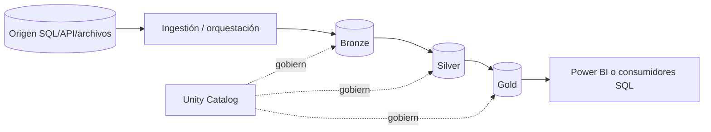

# 02 · Integraciones de Azure Databricks

[Índice DP-750](../README.md) · [← Arquitectura de Azure Databricks](../01-arquitectura/README.md) · [Seleccionar y configurar cómputo →](../03-seleccion-y-configuracion-de-computo/README.md)

**Progreso personal:** Estudiado. [Módulo oficial](https://learn.microsoft.com/en-us/training/modules/understand-azure-databricks-integrations/).

## Unidades

1. [Introduction](#unidad-01)
2. [Understand integration with Microsoft Fabric](#unidad-02)
3. [Understand integration with Power BI](#unidad-03)
4. [Understand integration with VS Code](#unidad-04)
5. [Understand integration with Power Platform](#unidad-05)
6. [Understand integration with Copilot Studio](#unidad-06)
7. [Understand integration with Microsoft Purview](#unidad-07)
8. [Understand integration with Microsoft Foundry](#unidad-08)
9. [Module assessment](#unidad-09)
10. [Summary](#unidad-10)

- [Desarrollo aplicado](#desarrollo-aplicado)
- [Laboratorio y comprobaciones](#laboratorio-y-comprobaciones)

## Unidad 01

### Introduction

Databricks transforma y gobierna datos; otras herramientas permiten consumirlos, automatizar acciones, producir informes o construir agentes de IA. Diseñar una integración exige responder cuatro preguntas: ¿los datos se **copian o consultan**?, ¿quién ejecuta las consultas?, ¿qué identidad se utiliza? y ¿dónde se aplican realmente los permisos?

[Unidad oficial](https://learn.microsoft.com/en-us/training/modules/understand-azure-databricks-integrations/1-introduction)

## Unidad 02

### Understand integration with Microsoft Fabric

Microsoft Fabric agrupa servicios de ingeniería, análisis y BI en una experiencia unificada. Databricks se especializa en procesamiento, Lakehouse y cargas de IA. Se pueden complementar de dos formas principales:

1. **Fabric accede a tablas Delta registradas en Unity Catalog** mediante catálogos reflejados y accesos directos (*shortcuts*) a los datos de origen. Al no copiar necesariamente los archivos, se reducen duplicidades; sin embargo, es imprescindible comprender el modelo de identidad y los permisos efectivos en Fabric.
2. **Databricks escribe resultados en OneLake**, usando rutas compatibles con ABFS, para que Fabric los analice o visualice. Se considera quién posee permisos de escritura, la región, la modalidad de autenticación y los costes de transferencia.

```text
Fuentes → Databricks (limpieza + transformación) → OneLake / Fabric → Power BI
                        └─────── Unity Catalog (metadatos y gobierno)
```

**Advertencia de seguridad:** al exponer datos de Unity Catalog a otra plataforma, no debes asumir que filtros de filas, máscaras de columnas o la identidad del usuario original se transmiten intactos. La unidad oficial señala restricciones relevantes de la opción de catálogo reflejado. Una integración no debe configurarse como si fuera siempre un DirectQuery con seguridad extremo a extremo.

#### Fabric como consumidor o destino

Dibuja el flujo antes de configurar permisos. Si un equipo de Fabric debe consumir tablas ya gobernadas en Databricks, evalúa el mecanismo disponible para acceder a datos de Unity Catalog desde Fabric y verifica qué credenciales usa, si hay materialización y quién administra el refresco. Si un pipeline de Databricks debe escribir archivos a OneLake, el sentido del flujo cambia. La identidad que escribe debe tener permisos en el destino de Fabric y la ruta tiene que corresponder al workspace y al elemento elegidos. Comprueba la tabla o los archivos desde el consumidor después de cargar. En ambos casos, registra dónde reside la fuente de verdad y qué identidades podrían leerla directamente.

[Unidad oficial](https://learn.microsoft.com/en-us/training/modules/understand-azure-databricks-integrations/2-integration-databricks-microsoft-fabric)

## Unidad 03

### Understand integration with Power BI

Power BI se conecta al endpoint de un **SQL warehouse** u otro cómputo compatible. En modo **Import**, incorpora una copia de datos en el modelo semántico que necesita refrescos periódicos: permite análisis rápidos, pero crea otra copia que debe protegerse. En **DirectQuery**, manda consultas al origen cuando el usuario interactúa; mantiene datos más cercanos al estado actual, pero afecta a latencia, concurrencia y costes del warehouse.

| Característica | Import | DirectQuery |
|---|---|---|
| Dónde se almacenan los datos del modelo | En Power BI | Principalmente en Databricks |
| Actualización | Refresco | Consultas en uso |
| Rendimiento | Suele ser rápido para modelo optimizado | Depende de Databricks y del diseño |
| Gobierno | Revisar reglas de la copia | Revisar autenticación y permisos delegados |

La conexión incluye hostname del servidor, ruta HTTP y autenticación; un SQL warehouse adecuado y datos bien modelados suelen ser preferibles a exponer tablas de ingestión crudas.

[Unidad oficial](https://learn.microsoft.com/en-us/training/modules/understand-azure-databricks-integrations/3-integration-databricks-power-bi)

## Unidad 04

### Understand integration with VS Code

La extensión de Databricks para VS Code permite trabajar con un proyecto local, autenticarse contra un workspace y desplegar o ejecutar código en recursos remotos. Este esquema separa la **experiencia de edición local** de la **ejecución sobre un entorno distribuido**. No todas las funciones del notebook web se trasladan exactamente al editor local: conviene comprobar la configuración del proyecto y del cómputo.

Flujo recomendado: abrir el repositorio Git → configurar perfil de Databricks → instalar dependencias en un entorno reproducible → asociar el proyecto al workspace → ejecutar pruebas y trabajos → subir cambios de código a Git, evitando incluir tokens.

#### Desarrollar, depurar y desplegar

En desarrollo local, abre el proyecto en VS Code y selecciona una configuración que apunte al workspace de desarrollo. Con Databricks Connect puedes enviar operaciones Spark al cómputo remoto desde el proceso local. El acceso a un fichero en Windows y el acceso de Spark a un volumen bajo `/Volumes` ocurren en contextos diferentes. Prueba primero una transformación pequeña y revisa tanto el intérprete Python local como las versiones admitidas por el cómputo remoto.

Un Declarative Automation Bundle declara contenido y recursos que el Databricks CLI valida y despliega a un *target*. Databricks Connect ayuda en el ciclo de desarrollo. El Bundle define el despliegue reproducible. Antes de desplegar revisa workspace, permisos de la identidad y parámetros del target. Para comprobar que una modificación solo apunta a desarrollo, inspecciona su configuración resuelta al validar y abre el recurso resultante en ese workspace.

[Unidad oficial](https://learn.microsoft.com/en-us/training/modules/understand-azure-databricks-integrations/4-integration-databricks-vscode)

## Unidad 05

### Understand integration with Power Platform

La Power Platform incluye herramientas como Power Apps y Power Automate. Los datos preparados en Databricks pueden alimentar aplicaciones de negocio y procesos automatizados mediante conectores, APIs o capas de acceso compatibles. Antes de conectar una aplicación, es importante analizar qué operaciones están permitidas, si se pueden escribir datos, cómo se autentica cada aplicación y cómo se limita el acceso a los usuarios finales.

**Ejemplo de arquitectura:** Databricks consolida métricas de clientes; una aplicación empresarial muestra sus indicadores y lanza un flujo de aprobación. Es preferible entregar una tabla o vista diseñada para ese consumo y no una tabla raw con datos sensibles innecesarios.

[Unidad oficial](https://learn.microsoft.com/en-us/training/modules/understand-azure-databricks-integrations/5-integration-databricks-power-platform)

## Unidad 06

### Understand integration with Copilot Studio

Copilot Studio permite definir agentes conversacionales y acciones. Puede aprovechar información que reside en Databricks a través de mecanismos admitidos por la integración. Un agente no debería recibir acceso indiscriminado a todo un catálogo: hay que diseñar identidades, controles de acceso, límites de consulta, calidad de las respuestas y supervisión de uso.

Diferencia importante: **un agente que consulta datos** no equivale a **un usuario humano con permisos heredados automáticamente**. El resultado depende del mecanismo concreto de conexión y de la identidad que ejecute la consulta.

[Unidad oficial](https://learn.microsoft.com/en-us/training/modules/understand-azure-databricks-integrations/6-integration-databricks-copilot-studio)

## Unidad 07

### Understand integration with Microsoft Purview

**Unity Catalog** gobierna activos dentro del ecosistema Databricks: permisos, metadatos, linaje y auditoría. **Microsoft Purview** ayuda a descubrir, catalogar y gobernar activos en un paisaje de datos más amplio de Microsoft y otras fuentes. Integrarlos puede ampliar la visibilidad corporativa, pero no reemplaza la configuración de permisos en Databricks.

Una organización puede usar Unity Catalog como punto de aplicación de las reglas de acceso y Purview como un plano transversal de descubrimiento y análisis de activos. **Catalogar** no significa **autorizar**.

[Unidad oficial](https://learn.microsoft.com/en-us/training/modules/understand-azure-databricks-integrations/7-integration-databricks-microsoft-purview)

## Unidad 08

### Understand integration with Microsoft Foundry

Microsoft Foundry aporta herramientas para construir soluciones y agentes de IA. Databricks puede servir como origen analítico y semántico mediante funciones admitidas, entre ellas espacios de **AI/BI Genie**. Genie permite formular preguntas de negocio en lenguaje natural sobre conjuntos de datos definidos; su calidad depende de la descripción de tablas, las relaciones, las instrucciones y los permisos.

**Diseño de referencia:** un agente recibe una pregunta → invoca una herramienta autorizada que consulta un espacio Genie → obtiene resultados fundamentados → explica la respuesta con los límites de los datos disponibles. Aun existiendo IA, se requieren controles contra consultas no deseadas y divulgación de información sensible.

[Unidad oficial](https://learn.microsoft.com/en-us/training/modules/understand-azure-databricks-integrations/8-integration-databricks-microsoft-foundry)

## Unidad 09

### Module assessment

- ¿Qué herramienta presentaría un panel empresarial? **Power BI**.
- ¿Qué facilita desarrollar código local y ejecutarlo remotamente? **Extensión Databricks para VS Code**.
- ¿Qué diferencia a Purview de Unity Catalog? **Gobierno transversal frente a administración y control de acceso de activos Databricks**.
- ¿Qué debe revisarse antes de conectar Fabric? **Identidad, seguridad efectiva, formatos admitidos y posible transferencia de datos**.

[Unidad oficial](https://learn.microsoft.com/en-us/training/modules/understand-azure-databricks-integrations/9-knowledge-check)

## Unidad 10

### Summary

Para elegir una integración, empieza por el consumidor y el contrato de datos. Power BI necesita un origen y un modelo semántico apropiados para sus necesidades de latencia. Purview necesita información de inventario y linaje para el ámbito que gobierna. VS Code aporta herramientas de desarrollo que se conectan al workspace adecuado. Microsoft Fabric permite proyectos donde se exponen datos a otros usuarios del ecosistema analítico. Antes de desplegar, verifica autenticación, permisos del objeto, red y el coste de las operaciones que realmente ejecutará cada consumidor.

[Unidad oficial](https://learn.microsoft.com/en-us/training/modules/understand-azure-databricks-integrations/10-summary)

## Desarrollo aplicado

### Diferenciar conexión, ingestión y consumo

No todas las integraciones hacen lo mismo. Una conexión puede permitir consultar un origen sin moverlo, una canalización de ingestión copia o sincroniza datos, mientras que una herramienta de BI consume tablas ya preparadas para obtener indicadores. Si se mezcla esta responsabilidad, es fácil diseñar dos transformaciones distintas para la misma métrica o duplicar almacenamiento sin motivo.

En una arquitectura representativa, ADF coordina extracciones o dependencias entre sistemas; Azure Databricks procesa datos y los almacena como tablas Delta; Unity Catalog controla el acceso a los productos de datos; Power BI consulta un modelo analítico preparado, en lugar de reconstruir cada regla de negocio. La elección de conectividad dependerá del volumen, el modo de actualización y el servicio concreto utilizado.



### Azure Data Factory y Databricks

Azure Data Factory resulta útil cuando debes relacionar diversas fuentes, ejecutar copias y coordinar dependencias externas. Databricks aporta un motor de transformaciones escalable y herramientas de ingeniería de datos. Si un pipeline de ADF invoca un notebook, considera la identidad usada, los parámetros de entrada, el resultado de salida, los reintentos y dónde se guardan los logs. No conviertas cada notebook en una caja negra sin contrato: documenta datos requeridos, tabla generada, estrategia ante duplicados y criterios de éxito.

### Power BI y los data marts

La capa de consumo debe exponer tablas o vistas con un grano bien definido. Power BI puede utilizar un mecanismo de conexión admitido por Azure Databricks; la elección entre importar datos y consultarlos bajo demanda afecta frescura, latencia y coste. Preparar una tabla Gold de ventas mensuales reduce trabajo repetido y facilita definiciones consistentes, pero no elimina la necesidad de seguridad de datos a nivel de consumidor.

```sql
CREATE OR REPLACE VIEW estudio.gold.ventas_por_mes AS
SELECT date_trunc('MONTH', fecha) AS mes,
       COUNT(*) AS num_ventas,
       SUM(importe) AS importe_total
FROM estudio.silver.ventas
GROUP BY date_trunc('MONTH', fecha);
```

Si la vista se usa desde varios informes, los equipos comparten las reglas de cálculo. Aun así, debes validar el tipo de dato `fecha`, los anulados y los importes nulos; un resultado numérico no implica automáticamente calidad de negocio.

### VS Code, repositorios y ciclo de desarrollo

La integración con herramientas de desarrollo debe apoyar la trazabilidad. Mantén el código versionado, usa ramas de trabajo, revisa cambios con pull requests y evita registrar credenciales. Los notebooks interactivos sirven para explorar, pero un pipeline productivo necesita parámetros, validaciones y despliegues repetibles. Distingue sincronizar código con un repositorio de ejecutar un trabajo en el workspace: son operaciones y permisos distintos.

**Ejercicio de arquitectura:** diseña una integración entre una base SQL y un informe semanal. Especifica cómo detectar cambios, qué servicio extrae, dónde almacenas Bronze, quién aplica reglas Silver, qué modelo Gold consume BI, cómo se recupera un fallo y qué ocurre si vuelves a ejecutar un día. El criterio clave es evitar duplicados y garantizar que un reintento no cambie erróneamente los totales.

## Laboratorio y comprobaciones

**Este módulo no presenta un laboratorio independiente en la colección DP-750T00 consultada.** Para consolidar la teoría, realiza una actividad de arquitectura propia: dibuja los componentes e integraciones descritos y justifica dónde se ejecuta el trabajo, cómo acceden las identidades y qué datos permanecen en cada servicio. [Índice de laboratorios oficiales](https://microsoftlearning.github.io/DP-750T00-Implement-Data-Engineering-Solutions-using-Azure-Databricks/)

### Práctica complementaria de integración con Power BI

Utiliza una tabla de lectura de un catálogo de pruebas y un SQL warehouse autorizado. En Databricks localiza los detalles de conexión del warehouse. En Power BI Desktop elige el conector de Azure Databricks e introduce el hostname y el HTTP path que muestra el recurso. Usa el método de autenticación que permita la organización. Selecciona catálogo, esquema y tabla y prueba primero un modelo pequeño. Para contrastar modos, crea por separado una prueba Import y una DirectQuery. Anota dónde se ejecuta la consulta al cambiar un filtro y qué ocurre después de actualizar los datos. Revisa el historial de consultas del warehouse para identificar qué solicita el informe. Si la conexión autentica pero no muestra la tabla, comprueba el permiso de uso del warehouse y los grants de Unity Catalog. Al acabar cierra los informes de prueba y detén un warehouse dedicado que hayas iniciado si tienes autorización.

## Fuentes y navegación

- [Fuentes de la certificación](../FUENTES.md)
- [Preparación y limpieza del entorno](../PREPARACION-LABORATORIOS.md)

[Índice DP-750](../README.md) · [← Arquitectura de Azure Databricks](../01-arquitectura/README.md) · [Seleccionar y configurar cómputo →](../03-seleccion-y-configuracion-de-computo/README.md)
