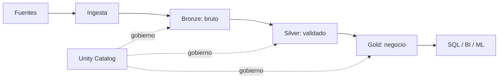

# 04 · Explorar Azure Databricks

[Índice DP-750](../README.md) · [← Seleccionar y configurar cómputo](../03-seleccion-y-configuracion-de-computo/README.md) · [Crear y organizar objetos de Unity Catalog →](../05-crear-y-organizar-objetos-en-unity-catalog/README.md)

**Progreso personal:** Estudiado. [Módulo oficial](https://learn.microsoft.com/en-us/training/modules/explore-azure-databricks/).

## Unidades

1. [Introduction](#unidad-01)
2. [Get started with Azure Databricks](#unidad-02)
3. [Identify Azure Databricks workloads](#unidad-03)
4. [Understand key concepts](#unidad-04)
5. [Data governance using Unity Catalog and Microsoft Purview](#unidad-05)
6. [Exercise - Explore Azure Databricks](#unidad-06)
7. [Module assessment](#unidad-07)
8. [Summary](#unidad-08)

- [Desarrollo aplicado](#desarrollo-aplicado)
- [Laboratorio y comprobaciones](#laboratorio-y-comprobaciones)

## Unidad 01

### Introduction

En proyectos tradicionales, la ingeniería de datos, el reporting y el machine learning pueden requerir plataformas separadas y múltiples copias de los datos. El enfoque **lakehouse** intenta reunir las posibilidades de un data lake (almacenamiento flexible y escalable) con las garantías analíticas de un data warehouse (estructuración, transacciones y consultas SQL).

Una solución típica utiliza almacenamiento de objetos, tablas Delta, Spark para preparación y SQL warehouses para consumo. Unity Catalog aporta gobierno por encima de estos recursos; los notebooks y los jobs ofrecen los flujos de ejecución.

[Unidad oficial](https://learn.microsoft.com/en-us/training/modules/explore-azure-databricks/01-introduction)

## Unidad 02

### Get started with Azure Databricks

Un workspace Azure Databricks se aprovisiona como recurso Azure, en una región, una suscripción y un grupo de recursos, sujeto a permisos y condiciones organizativas. Dentro del workspace se configura identidad, conectividad, cómputo y acceso al metastore. La selección de región puede influir en proximidad a los datos, latencia, residencia y coste.

**No confundir:** el recurso Azure permite crear el servicio; no es automáticamente una autorización de lectura a todas las tablas. Azure RBAC, identidades y privilegios de Unity Catalog cumplen funciones distintas.

[Unidad oficial](https://learn.microsoft.com/en-us/training/modules/explore-azure-databricks/02-azure-databricks)

## Unidad 03

### Identify Azure Databricks workloads

- **Ingeniería de datos:** ingesta, validación, transformación, modelado, orquestación.
- **Análisis de datos:** SQL, métricas, dashboards, exploración.
- **Ciencia de datos / ML:** preparación de características, experimentación, entrenamiento y aplicación de modelos.
- **Streaming:** captura de eventos y cálculo incremental.

En un proceso batch, una tarea transforma datos que llegan periódicamente. En streaming, el motor mantiene un proceso incremental y un checkpoint de estado, pero el resultado no siempre es instantáneo: depende del trigger, fuente, red y recursos.

[Unidad oficial](https://learn.microsoft.com/en-us/training/modules/explore-azure-databricks/03-workloads)

## Unidad 04

### Understand key concepts

**Apache Spark:** motor distribuido con APIs de DataFrames, SQL y procesamiento de flujos. **Notebook:** documento ejecutable que combina código, texto y salidas. **Job:** ejecución programada o desencadenada con tareas y dependencias. **Delta Lake:** formato de tabla con registro transaccional, cambios y capacidades de consulta histórica sujetas a retención. **Unity Catalog:** gobernanza de datos y activos.



La arquitectura Medallion (Bronze, Silver, Gold) es un patrón útil, **no una obligación universal**. Bronze conserva detalles de llegada; Silver mejora calidad, deduplica y estandariza; Gold produce entidades para consumo. El diseño correcto depende del caso de negocio.

[Unidad oficial](https://learn.microsoft.com/en-us/training/modules/explore-azure-databricks/04-key-concepts)

## Unidad 05

### Data governance using Unity Catalog and Microsoft Purview

Unity Catalog permite localizar objetos, otorgar permisos, descubrir linaje y aplicar políticas, mientras Purview aporta una visión más amplia del patrimonio de datos empresarial. Un catálogo bien construido necesita convenciones de nombres, propietarios y descripciones; sin esos detalles, la plataforma funciona técnicamente pero resulta difícil de descubrir y mantener.

[Unidad oficial](https://learn.microsoft.com/en-us/training/modules/explore-azure-databricks/05-data-governance-using-unity-catalog-and-microsoft-purview)

## Unidad 06

### Exercise - Explore Azure Databricks

Crear un notebook que lea un pequeño dataset, filtre filas no válidas, agrupe por categoría y guarde un resultado en una tabla de un esquema de pruebas. Identificar qué cómputo ejecutó el notebook y qué permisos permiten crear la tabla. Después consultar la tabla desde SQL.

**Preguntas:** ¿qué diferencia hay entre lakehouse y warehouse? ¿Por qué importa la transaccionalidad de Delta? ¿Una tabla de Unity Catalog es el mismo objeto que un notebook? ¿En qué capa aplicarías limpieza de datos?

[Unidad oficial](https://learn.microsoft.com/en-us/training/modules/explore-azure-databricks/06-exercise-explore-databricks)

## Unidad 07

### Module assessment

**Caso de evaluación.** Debes preparar informes horarios basados en archivos que se reciben en cloud storage y ejecutar una transformación reproducible. Identifica un mecanismo de ingestión, un objeto gobernado para datos tabulares y un job para programar el trabajo. Si el flujo importa un CSV como fichero para inspección, un volumen organiza el archivo. Una tabla contiene las filas tipadas listas para consultar y puede derivarse de ese fichero. El permiso del volumen y el permiso de la tabla se conceden sobre objetos diferentes.

[Unidad oficial](https://learn.microsoft.com/en-us/training/modules/explore-azure-databricks/07-knowledge-check)

## Unidad 08

### Summary

El workspace organiza los artefactos de trabajo. El compute ejecuta el código y Unity Catalog gobierna los objetos consultados. Revisa cada capa al trasladar un notebook entre entornos. Para hacer portable el código, declara los valores que cambian entre entornos y utiliza nombres de tres partes. Cuando una sesión lee un archivo de Unity Catalog, registra volumen y ruta de origen además de la tabla producida.

[Unidad oficial](https://learn.microsoft.com/en-us/training/modules/explore-azure-databricks/08-summary)

## Desarrollo aplicado

### Comprender qué ocurre cuando ejecutas un notebook

Un notebook de Azure Databricks no es simplemente un editor de Python conectado a una máquina virtual. Es una interfaz de ejecución que envía comandos a un contexto de cómputo capaz de ejecutar Spark y otros motores admitidos. La aplicación web conserva la organización del espacio de trabajo, las identidades y los controles administrativos; el cómputo realiza el trabajo y el almacenamiento persiste los datos. Esta separación explica por qué guardar un notebook no guarda automáticamente los resultados en una tabla, y por qué al terminar el cómputo sigues conservando el código y los datos persistidos pero puedes perder variables temporales y cachés.

En Spark, el código del usuario se evalúa en un *driver* que planifica tareas y las distribuye entre *executors* cuando la operación es distribuida. Una instrucción como `spark.read.table(...)` crea un DataFrame lógico; muchas transformaciones se construyen de forma diferida y solo se ejecutan de verdad cuando se necesita materializar el resultado, por ejemplo en una escritura, un `count()` o una visualización. Este comportamiento —evaluación perezosa— es fundamental para interpretar tiempos de ejecución y evitar llamadas innecesarias a `collect()`.

### Crear un flujo completo reproducible

Como ejemplo didáctico independiente del laboratorio oficial, supongamos una fuente de ventas con identificador, cliente, fecha y total. Primero se establece explícitamente el esquema para evitar que cada ingestión infiera tipos diferentes. Después se escriben los registros válidos en una tabla Delta de Unity Catalog. Utiliza un catálogo y esquema de prácticas donde dispongas de permisos; los nombres siguientes son ilustrativos.

```python
from pyspark.sql import functions as F, types as T

schema = T.StructType([
    T.StructField("id_venta", T.LongType(), False),
    T.StructField("cliente", T.StringType(), True),
    T.StructField("fecha", T.StringType(), True),
    T.StructField("importe", T.DoubleType(), True)
])

filas = [(1, "Ana", "2026-11-01", 42.5),
         (2, "Luis", "2026-11-02", 18.0)]
df = spark.createDataFrame(filas, schema)
limpio = (df.withColumn("fecha", F.to_date("fecha"))
            .filter(F.col("id_venta").isNotNull())
            .filter(F.col("importe") >= 0))
limpio.write.format("delta").mode("overwrite").saveAsTable("estudio.demo.ventas")
```

`mode("overwrite")` sustituye el contenido y **no** es la política adecuada para cualquier carga productiva: si el origen aporta solo cambios incrementales se necesita `MERGE`, `COPY INTO`, streaming o una estrategia de idempotencia. Para consultar los resultados desde SQL, ejecuta `SELECT * FROM estudio.demo.ventas;`. En Catalog Explorer podrás ver el objeto, columnas y permisos concedidos.

### Workspaces, catálogos, esquemas y archivos

No confundas una carpeta del workspace con un esquema de base de datos. Las carpetas del workspace organizan notebooks, consultas y recursos de colaboración. Unity Catalog organiza datos con identificadores de tres niveles, por ejemplo `catalogo.esquema.tabla`. Los volúmenes de Unity Catalog permiten almacenar y gobernar archivos no tabulares; no equivalen a tablas Delta. El directorio de código no debe actuar como ubicación improvisada de almacenamiento de datasets empresariales.

### Actividad guiada y comprobaciones

1. Abre el workspace y localiza la sección de cómputo, el explorador de catálogos y los notebooks.
2. Comprueba qué identidades y permisos se requieren para crear un esquema y una tabla.
3. Ejecuta primero la creación del DataFrame y comprueba `printSchema()` y `show()`.
4. Escribe el resultado en una tabla de laboratorio y vuelve a consultar los datos desde otra sesión.
5. Detén el cómputo y verifica qué persiste: el notebook y la tabla deben seguir existiendo, aunque la sesión ya no contenga las variables anteriores.

**Errores frecuentes:** usar una ubicación de tabla que no existe; ejecutar sin permisos `USE CATALOG` o `USE SCHEMA`; confundir una tabla temporal registrada en la sesión con un objeto persistente; almacenar contraseñas en una celda; ejecutar `collect()` sobre un conjunto muy grande. El éxito del laboratorio no consiste solo en que una celda termine, sino en poder explicar qué recursos intervienen y qué datos quedan gobernados.

## Laboratorio y comprobaciones

**Ejercicio oficial:** [Abrir las instrucciones de MicrosoftLearning](https://microsoftlearning.github.io/DP-750T00-Implement-Data-Engineering-Solutions-using-Azure-Databricks/Instructions/Labs/01-explore-azure-databricks.html)  
**Notebook oficial:** [Importar o consultar notebook `.ipynb`](https://raw.githubusercontent.com/MicrosoftLearning/DP-750T00-Implement-Data-Engineering-Solutions-using-Azure-Databricks/refs/heads/main/Allfiles/01-explore-azure-databricks.ipynb)  
**Naturaleza de esta sección:** itinerario explicado con redacción propia y comprobaciones de aprendizaje. Las celdas exactas y el material de origen están en el notebook oficial enlazado; no se reproducen íntegramente aquí.


### Caso práctico: CityMoves Transit — primeros pasos en el workspace

**Finalidad:** conocer la interfaz real del workspace, trabajar con archivos en volúmenes de Unity Catalog y familiarizarse con notebooks de Python, SQL y Markdown. En el recurso original, los ejercicios continúan dentro de un notebook proporcionado por Microsoft.

**Preparación y permisos.** Es necesario disponer de un workspace Premium y acceso al catálogo de práctica. La guía oficial de aprovisionamiento utiliza el workspace `adb-dp750`. Si trabajas en tu propio workspace, ajusta los nombres; crear recursos puede generar costes.

**Secuencia recomendada de ejecución:**

1. Accede al workspace y localiza las áreas **Workspace**, **Catalog**, **Compute**, **Jobs & Pipelines** y la búsqueda de activos. En **New**, observa qué tipos de recursos puedes crear y qué diferencias hay entre un notebook, una consulta y un job.
2. Revisa el asistente integrado, si está disponible: su objetivo es ayudar a escribir y comprender código, no sustituir la comprobación del resultado. En un contexto de examen, no presupongas que estará permitido utilizarlo.
3. Abre **Catalog Explorer**; bajo el catálogo de prácticas y el esquema `default`, crea un volumen **managed** llamado `lab_data`. Comprueba el nombre cualificado y la ruta `/Volumes/<catalogo>/default/lab_data/`.
4. Utiliza la interfaz de carga de datos para depositar un CSV de líneas o rutas de transporte en dicho volumen. Antes de transformarlo, verifica que el archivo aparezca en el explorador del volumen. El material oficial ofrece `routes.csv` en su repositorio.
5. Importa el notebook oficial **desde URL** en una carpeta de Workspace, abre el archivo y selecciona un cómputo compatible (la práctica oficial propone Serverless).
6. Recorre las celdas: ejecuta Python básico, cambia el lenguaje mediante `%sql` donde proceda y añade comentarios en Markdown. Examina cómo se muestran resultados tabulares y cómo quedan almacenadas las definiciones de las celdas.

**Verificaciones de aprendizaje:** distingue *subir un archivo a un volumen* de *crear una tabla Delta*; confirma que no es necesario crear una tabla para visualizar el CSV en el volumen; explica qué trabajo realiza el cómputo y qué registra Unity Catalog.

**Evidencias sugeridas:** captura del volumen con el CSV, notebook con celdas Python/SQL/Markdown y selector de cómputo.

### Verificación complementaria del archivo

En el laboratorio oficial se sube `routes.csv` al volumen `lab_data` del esquema `default` del catálogo de prácticas. Desde Catalog Explorer copia la ruta del volumen. Si el catálogo se llama `adb-dp750`, el siguiente ejemplo lista sus ficheros desde el notebook. Necesitarás acceso al catálogo, esquema y volumen para realizar la comprobación.

```python
archivos = dbutils.fs.ls("/Volumes/adb-dp750/default/lab_data")
assert any(f.name == "routes.csv" for f in archivos)
```

En un entorno con nombre distinto, sustituye el segmento del catálogo por el que aparece en la interfaz. Este control valida que el archivo está en el volumen y que la sesión puede acceder a él. La calidad y el esquema del CSV se revisan cuando se ingiere a una tabla. Si falla, comprueba primero que la subida terminó, que el notebook se ejecuta en el workspace correcto y que la identidad tiene permisos de lectura del volumen.

## Fuentes y navegación

- [Fuentes de la certificación](../FUENTES.md)
- [Preparación y limpieza del entorno](../PREPARACION-LABORATORIOS.md)

[Índice DP-750](../README.md) · [← Seleccionar y configurar cómputo](../03-seleccion-y-configuracion-de-computo/README.md) · [Crear y organizar objetos de Unity Catalog →](../05-crear-y-organizar-objetos-en-unity-catalog/README.md)
