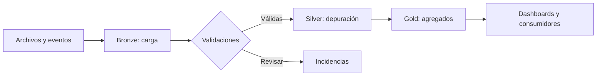

[🏠 Índice](../README.md) · [← Anterior](../11-calidad-de-datos/README.md) · [Siguiente →](../13-implementacion-lakeflow-jobs/README.md)

> **Estado de estudio:** 🕒 Pendiente · **Unidades oficiales:** 10 · [Microsoft Learn](https://learn.microsoft.com/en-us/training/modules/design-implement-data-pipelines/)  
> **Versión de apuntes:** 14-11-2026 · Contenido técnico redactado de forma original a partir del itinerario de Microsoft.

# 12. Diseño e implementación de canalizaciones de datos

## 12.1. De tareas sueltas a un proceso reproducible

Un **pipeline** transforma una entrada en un producto de datos mediante operaciones relacionadas. Frente a ejecutar un notebook manual, un pipeline productivo especifica fuentes, transformaciones, destino, dependencias, validaciones, errores, estado y condiciones de reejecución. **Orquestar** es decidir qué tarea se ejecuta, cuándo y en qué secuencia; **procesar** es ejecutar sus cálculos y escrituras.

Una arquitectura **Medallion** frecuente se divide en **Bronze** (copias cercanas al origen, auditables), **Silver** (calidad, tipado, relaciones) y **Gold** (indicadores listos para consumo). No es obligatorio que haya exactamente tres capas físicas en cada sistema; sí conviene mantener contratos claros entre etapas.



## 12.2. Determinar el orden de las operaciones

Un orden razonable: **identificación de fuentes → ingesta → comprobaciones de estructura → limpieza → enriquecimiento → agregación → publicación → controles posteriores**. El orden se ajusta al caso: por ejemplo, el filtrado temprano reduce costes, pero eliminar filas antes de registrarlas puede destruir rastros necesarios para auditoría.

Las dependencias son un **grafo acíclico dirigido (DAG)**: una tarea comienza cuando sus predecesoras satisfacen una condición de éxito o de finalización. Hay tareas estrictamente secuenciales y otras que pueden ejecutarse en paralelo. Un DAG explícito reduce las carreras entre escritores y consumidores.

## 12.3. Notebooks frente a Lakeflow Declarative Pipelines

**Notebooks** proporcionan control imperativo en Python/SQL, útiles para prototipos y transformaciones específicas. Pueden ejecutarse como tareas de Lakeflow Jobs y requieren que el autor controle dependencias, idempotencia y gestión de errores. **Lakeflow Spark Declarative Pipelines** permite declarar datasets, flujos y restricciones de calidad; el motor organiza actualizaciones y parte de la lógica operativa.

| Decisión | Notebook como tarea | Declarative Pipeline |
|---|---|---|
| Programación | Código imperativo y ordenado | Relaciones declaradas entre datasets |
| Gestión de dependencias | En Jobs y en código | A partir del grafo de datasets |
| Validaciones | Lógica propia | Expectations integradas |
| Caso típico | Transformación especializada | Ingesta y refinamiento continuo |

Se pueden combinar: una canalización declarativa produce tablas Silver y un Job ejecuta controles o tareas posteriores. No confundas el recurso **Jobs** con el recurso **Pipelines**, aunque aparezcan en el mismo menú.

## 12.4. Diseño de Lakeflow Jobs y dependencias

Un job contiene tareas, cada una con identidad, tipo, recurso de cómputo, parámetros y políticas de reintento. Algunas tareas son notebooks, otras SQL, ejecución de pipeline, condición If/else u operaciones de otra naturaleza compatible. El orquestador calcula qué puede iniciar a partir de `depends_on` y las reglas de ejecución tras las dependencias.

**Ejemplo:** cargar 100.000 reservas, validarlas, calcular indicadores por hotel. Si falla la validación, no debe publicarse Gold como si el conjunto estuviera completo. Una rama puede registrar incidencias y otra continuar la publicación únicamente cuando se cumpla el umbral.

```text
                 ┌→ revisar_rechazos ─→ notificar
bronze → silver ─┤
                 └→ quality_gate ─────→ gold
```

En el laboratorio de Microsoft aparece `dbutils.widgets` para parámetros y `dbutils.jobs.taskValues` para comunicar valores entre tareas. El tipo de dato, el alcance y la existencia del valor deben controlarse: no conviene confiar en que cualquier salida del notebook estará disponible para cualquier tarea descendente.

## 12.5. Errores, reintentos y operaciones seguras

Los fallos pueden ser **transitorios** (red, latencia de almacenamiento, servicio temporalmente indisponible), **deterministas** (código incorrecto, esquema incompatible) o **de negocio** (datos inadmisibles). Los transitorios a menudo justifican reintentos con espera. Los deterministas no se arreglan repitiendo el mismo código. Los de negocio requieren una política de calidad.

Un bloque `try/except` puede registrar contexto y volver a propagar la excepción. **No ocultes errores**: si el notebook finaliza con éxito después de capturar todo sin avisar, el Job interpretará que la tarea ha terminado correctamente. Registra métricas, identificadores de ejecución y una causa recuperable, evitando imprimir secretos.

Los reintentos deben ser **idempotentes**: ejecutar de nuevo no debe crear facturas o filas duplicadas. Se puede conseguir mediante `MERGE` por clave, staging temporal, operaciones de reemplazo controlado o marcas de lote. `append` puro no es idempotente salvo que la lógica de origen ya garantice unicidad.

## 12.6. Control de costes, trazabilidad y ejecución

Selecciona el tipo de cómputo conforme al SLA y la carga. Evita mantener recursos interactivos activos para jobs pequeños programados. Etiqueta los trabajos, establece un propietario y conserva un identificador de ejecución para correlacionar logs, métricas y resultados.

Documenta el contrato de cada etapa: entradas, columnas requeridas, reglas de salida, actualizaciones permitidas, frecuencia, destino de errores y retención. Cuando una dependencia cambia, el consumidor debe detectarlo antes de generar métricas incorrectas.

## 12.7. Repaso razonado

1. **¿Qué diferencia hay entre un notebook y un job?** El primero contiene código y análisis; el segundo configura cómo se ejecutan tareas de forma orquestada.
2. **¿Por qué no conviene tratar siempre los fallos con retry?** Un error determinista persistirá y solo encarecerá la carga.
3. **¿Qué previene una clave de lote e idempotencia?** Duplicaciones al reejecutar una etapa.
4. **¿Por qué medir los rechazados en Silver?** Para saber si Gold se calculó sobre un subconjunto fiable o una muestra sesgada.

---

## 🧪 Guía de laboratorio y comprobación práctica

**Ejercicio oficial:** [Abrir las instrucciones de MicrosoftLearning](https://microsoftlearning.github.io/DP-750T00-Implement-Data-Engineering-Solutions-using-Azure-Databricks/Instructions/Labs/10-design-implement-data-pipelines.html)  
**Notebook oficial:** [Importar o consultar notebook `.ipynb`](https://raw.githubusercontent.com/MicrosoftLearning/DP-750T00-Implement-Data-Engineering-Solutions-using-Azure-Databricks/refs/heads/main/Allfiles/10-design-implement-data-pipelines.ipynb)  
**Naturaleza de esta sección:** itinerario explicado con redacción propia y comprobaciones de aprendizaje. Las celdas exactas y el material de origen están en el notebook oficial enlazado; no se reproducen íntegramente aquí.


### Caso práctico: GlobStay — un pipeline de reservas hoteleras por capas

**Objetivo:** producir indicadores de ocupación y reservas desde registros crudos y después convertir el notebook en un flujo orquestado, con gestión de errores y decisiones condicionales.

**Parte A — lógica de datos en notebook:**

1. Importa el notebook de Microsoft y ejecuta las celdas iniciales. Examina la tabla Bronze de reservas y qué campos son necesarios para un procesamiento fiable.
2. Implementa Silver eliminando duplicados por identificador, descartando valores no válidos de tarifa y fecha y registrando el número de registros excluidos. La transformación debería ser determinista, auditable e idempotente al repetirse.
3. Construye Gold con indicadores de ingresos por hotel y por canal de adquisición; evita sumar tarifas como si fueran ingresos totales sin tener en cuenta duración o importe real de las reservas.
4. Usa parámetros de notebook para seleccionar una capa (`layer`) y estructuras `try/except` para detectar y propagar errores. Comprueba cómo se comparten valores entre tareas con `dbutils.jobs.taskValues` cuando resulta adecuado.

**Parte B — orquestación desde la UI:**

5. En **Jobs & Pipelines**, crea un job llamado `GlobStay Booking Pipeline` con tres tareas de notebook: `ingest_bronze` → `clean_silver` → `aggregate_gold`. Utiliza cómputo Serverless si está soportado.
6. En la tarea Silver configura **dos reintentos** separados por **60 segundos**. Pasa el parámetro `layer=silver`; para Gold, `layer=gold`. En una implementación real, evita que ejecutar el mismo notebook entero tres veces produzca efectos duplicados: comprueba la lógica de enrutamiento y los widgets del cuaderno.
7. Activa notificaciones de error a un correo tuyo y ejecuta el job manualmente. Inspecciona el DAG y las salidas de cada tarea.
8. Añade una verificación de calidad posterior a Silver y una tarea **If/else condition** que use un valor de tarea correctamente publicado. Si se supera el umbral de incidencias, dirige la ejecución a una ruta de alerta; si no, a la continuación Gold.

**Ejemplo de control propio:** `numero_errores <= 5` permite continuar; si hay más, registrar un incidente. El número 5 es un umbral de ejemplo del ejercicio, no un estándar profesional aplicable a todas las fuentes.

**Verificación:** observa dependencias, estado de tareas, reintentos y parámetros; explica por qué un try/except dentro del notebook resuelve errores de negocio distintos a los reintentos de fallos transitorios del orquestador.


---

### 📚 Fuentes y navegación

- [Contenido oficial de Microsoft Learn](https://learn.microsoft.com/en-us/training/modules/design-implement-data-pipelines/)
- [Repositorio docente de laboratorios DP-750T00](https://microsoftlearning.github.io/DP-750T00-Implement-Data-Engineering-Solutions-using-Azure-Databricks/)
- [Guía oficial de competencias del examen DP-750](https://learn.microsoft.com/en-us/credentials/certifications/resources/study-guides/dp-750)

[🏠 Índice](../README.md) · [← Anterior](../11-calidad-de-datos/README.md) · [Siguiente →](../13-implementacion-lakeflow-jobs/README.md)
