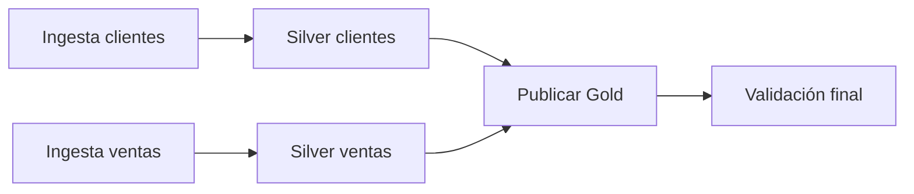

[🏠 Índice](../README.md) · [← Anterior](../12-diseno-de-pipelines/README.md)

> **Estado de estudio:** 🕒 Pendiente · **Unidades oficiales:** 9 · [Microsoft Learn](https://learn.microsoft.com/en-us/training/modules/implement-lakeflow-jobs/)  
> **Versión de apuntes:** 15-11-2026 · Contenido técnico redactado de forma original a partir del itinerario de Microsoft.

# 13. Implementación y operación de Lakeflow Jobs

## 13.1. Concepto y componentes de un Job

Un **Lakeflow Job** es una definición de ejecución coordinada que se puede lanzar manualmente, programar o activar por eventos. Un job agrupa **tareas**, **dependencias**, **parámetros**, **recursos de cómputo**, **triggers**, **políticas de error** y **notificaciones**. Cada lanzamiento produce una **run** cuyo estado y resultados deben consultarse para determinar si el producto de datos es correcto.

Una tarea no equivale a todo el job: el job puede informar de fallo cuando una de sus ramas obligatorias no acaba correctamente. El significado de éxito también depende de las condiciones `Run if` y del tratamiento de tareas omitidas o canceladas.

## 13.2. Configurar tareas, parámetros y credenciales

En la interfaz **Jobs & Pipelines**, un job puede incluir tareas del tipo Notebook, SQL y otros soportados. Para cada tarea se selecciona el archivo o consulta, el cómputo permitido y, opcionalmente, parámetros. Los parámetros del job sirven para cambiar fecha de proceso, mercado o un identificador de lote sin duplicar el código.

Usa nombres significativos como `process_cdrs`, `summarize_gold`, `validate_quality`. Mantén un propósito por tarea y evita repetir todo el pipeline en un notebook si solo necesitas ejecutar una fase. Las identidades usadas para ejecutar y leer datos deben recibir solo los privilegios necesarios.

Los **parámetros dinámicos** representan propiedades de una ejecución como su instante de disparo, pero la sintaxis concreta depende de la plataforma. Valida su sustitución en la vista del job y en el notebook sin asumir que se inserta automáticamente un formato compatible con tu parser.

## 13.3. Triggers: manuales, programación y eventos

| Activación | Ventaja | Consideraciones |
|---|---|---|
| Manual | Ideal para pruebas y recuperaciones | Necesita intervención |
| Scheduled | Regularidad y planificación | Puede ejecutar sin datos nuevos |
| File arrival | Reacciona a nuevos ficheros | Debe controlarse acumulación y duplicados |
| Table update | Responde a modificaciones de tablas admitidas | Depende de soporte y permisos |

Los jobs activados por archivo pueden agrupar llegadas muy próximas mediante una espera de estabilización. Sin embargo, un job activado no implica que los archivos se procesen una sola vez: la deduplicación y el checkpoint pertenecen a la lógica de procesamiento.

**Expresiones cron:** Databricks puede usar sintaxis Quartz con campo de segundos, distinta del cron tradicional de Linux. Por ejemplo, `0 0 2 * * ?` representa una ejecución diaria a las 02:00 según la zona horaria configurada. Comprueba siempre los cambios de horario de verano y el calendario mostrado en la UI.

## 13.4. Avisos, reintentos y recuperación

Las **notificaciones** de trabajo alertan por estados como error o duración excesiva. Las **políticas de retry** reejecutan una tarea cuando se produce un fallo recuperable; pueden incluir número máximo de intentos e intervalo. Una **advertencia de duración** no es lo mismo que un **timeout** que aborta la tarea al superar su límite.

La funcionalidad de reparación permite recuperar una ejecución fallida sin repetir necesariamente todos los pasos, según el tipo de tarea, dependencias y estado. Antes de reintentar, confirma si el fallo dejó resultados parcialmente escritos, pues una reparación sin operaciones idempotentes puede duplicar salidas.

Diseño recomendado: reintentos cortos para errores transitorios, notificación final si se agotan, y un procedimiento de diagnóstico que revise logs del notebook, políticas de ejecución y resultados parciales. Los correos deben dirigirse a un contacto real y autorizado de operaciones.

## 13.5. Supervisar el DAG y el historial de ejecuciones

**Runs** muestra el historial por fecha y estado. La vista de DAG ayuda a identificar qué tarea bloqueó a las demás. El detalle de ejecución permite consultar duración, logs, parámetros y mensajes de error. Para una incidencia, anota: job ID, run ID, task key, tiempo de inicio, recurso de cómputo, excepción y tablas afectadas.

Un fallo en un SQL warehouse podría estar relacionado con permisos o falta de datos, no con la lógica del notebook anterior; observar el DAG no reemplaza revisar el contenido del error. Si el job contiene ramas condicionales, comprueba por qué una tarea fue omitida y si la condición interpretó correctamente el valor recibido.

## 13.6. Diseño operativo de un pipeline diario

Considera registros de telecomunicaciones que llegan varias veces al día. En Bronze almacenas el lote y su identificador; Silver depura esquemas, fechas, duraciones y códigos; Gold agrega caídas de llamadas por zona y tecnología. El Job debe decidir cuándo actualizar Gold y con qué periodo de proceso.

La ejecución a las 02:00 puede ser razonable para un informe matutino, pero un trigger por archivos será mejor para requisitos de baja latencia. Si los datos pueden llegar tarde, diseña ventanas de reprocesamiento e implementa un `MERGE` o actualización controlada para los periodos afectados.

**Buenas prácticas de seguridad:** administra el propietario del job, revisa permisos de los objetos UC, evita secretos en widgets y controla quién puede editar triggers o reenviar resultados a destinos externos.

## 13.7. Repaso razonado

1. **¿Por qué una tarea SQL necesita una consulta guardada?** Porque el Job referencia un objeto de consulta configurado, no un bloque de SQL arbitrario en todos los modos.
2. **¿Qué ocurre al sustituir un trigger de llegada por uno cron?** La ejecución deja de depender de archivos y pasa a ocurrir a las horas programadas.
3. **¿Cuál es el riesgo de reintentar un append?** Repetir filas si no se conserva una clave de lote y deduplicación.
4. **¿De qué sirve la vista Runs?** Permite localizar errores, tiempos, parámetros y la tarea que bloqueó el pipeline.

---

## Desarrollo en profundidad: orquestación diaria con Lakeflow Jobs

### Job, tarea, ejecución y trigger

Un **job** define qué tareas deben ejecutarse y en qué condiciones. Una **tarea** puede referirse a un notebook, un pipeline u otro tipo de recurso soportado. Una **ejecución** es una instancia concreta del job o de una tarea y tiene estado, duración, parámetros y resultados. El **trigger** determina cuándo empieza: manual, programado u otros mecanismos disponibles. Estas entidades no son equivalentes: modificar la programación no cambia el código de una tarea y reiniciar un job no implica necesariamente borrar el estado de sus datos.

### Diseño de un DAG con dependencias

Supongamos que `ingest_clientes` y `ingest_ventas` pueden ejecutarse en paralelo. `silver_clientes` depende del primero; `silver_ventas` del segundo. `publicar_gold` depende de ambos, y una última tarea valida los indicadores publicados. Si solo una rama falla, el sistema debe ofrecer información suficiente para reparar la parte defectuosa sin repetir innecesariamente tareas costosas.

### Programaciones y zonas horarias

Una programación debe documentar zona horaria, calendario, objetivo de finalización y comportamiento durante cambios de horario. Un job a las 02:30 puede verse afectado por el cambio de hora si utiliza una zona con horario de verano. Para ejecuciones con datos diarios, conviene calcular una **fecha lógica de proceso** independiente de `current_timestamp()` y pasarla como parámetro. Así una reparación del día anterior procesa exactamente el periodo esperado.

### Concurrencia y deduplicación

Si una ejecución dura más que su intervalo de programación, puede coincidir con otra. Limitar concurrencia protege recursos y evita escrituras simultáneas incompatibles. Pero impedir solapamientos no sustituye la idempotencia: reintentos manuales, reparaciones y ejecuciones lanzadas por usuarios también deben gestionar entradas repetidas.

### Alertas, reintentos y recuperación

Configura notificaciones a responsables pertinentes y evita un exceso de alertas que termine ignorándose. Establece máximo de reintentos, intervalos y, cuando proceda, timeout. Un error de permisos no suele resolverse repitiendo diez veces; una indisponibilidad transitoria podría hacerlo. Después de una incidencia, determina qué datasets se escribieron y si los consumidores observaron un estado parcial.

### Checklist operativa

| Pregunta | Resultado esperado |
|---|---|
| ¿Quién ejecuta el job? | Principal autorizado y estable |
| ¿Qué datos procesa? | Parámetros y periodo definidos |
| ¿Cómo evita duplicados? | Idempotencia y claves verificadas |
| ¿Qué sucede si falla? | Estado visible, reintento o reparación controlados |
| ¿Cuándo se avisa? | Umbrales y destinatarios documentados |
| ¿Cómo se audita? | Logs, historial y enlaces a ejecuciones |

**Práctica:** configura en un entorno de pruebas un job con dos notebooks dependientes, un parámetro `fecha_proceso`, una alerta de fallo y una política de reintentos apropiada. Provoca una excepción controlada en la segunda tarea, observa los estados y practica la reparación. Finalmente registra la diferencia entre lanzar el job, reiniciar una ejecución completa y reparar únicamente tareas fallidas; la disponibilidad exacta de opciones depende de la interfaz y las funciones habilitadas.

---

## 🧪 Guía de laboratorio y comprobación práctica

**Ejercicio oficial:** [Abrir las instrucciones de MicrosoftLearning](https://microsoftlearning.github.io/DP-750T00-Implement-Data-Engineering-Solutions-using-Azure-Databricks/Instructions/Labs/11-implement-lakeflow-jobs.html)  
**Notebook oficial:** [Importar o consultar notebook `.ipynb`](https://raw.githubusercontent.com/MicrosoftLearning/DP-750T00-Implement-Data-Engineering-Solutions-using-Azure-Databricks/refs/heads/main/Allfiles/11-implement-lakeflow-jobs.ipynb)  
**Naturaleza de esta sección:** itinerario explicado con redacción propia y comprobaciones de aprendizaje. Las celdas exactas y el material de origen están en el notebook oficial enlazado; no se reproducen íntegramente aquí.

### Caso práctico: TelConnect — automatización de registros CDR

**Necesidad:** una operadora de telecomunicaciones transforma llamadas y sesiones de datos (CDR) y necesita automatizar una salida Gold cada noche, con avisos cuando falla un paso.

**Parte A — preparar los datos:**

1. Importa el notebook y ejecútalo en cómputo compatible. El material crea `telconnect_lab` con `bronze`, `silver`, `gold`, un volumen `raw_uploads`, un CSV de CDR y tablas transformadas.
2. Revisa que la capa Gold contiene `network_summary` y que puedes consultar indicadores de llamadas y fallos por región y tipo de red. Localiza el widget o parámetro `processing_date` en el notebook.

**Parte B — construir y automatizar el job:**

3. Crea `TelConnect CDR Pipeline`. Primera tarea: `process_cdrs`, tipo Notebook, usando el notebook importado y un recurso de cómputo compatible.
4. Registra un parámetro de job `processing_date` y vincúlalo a la fecha de ejecución mediante la sintaxis dinámica que indique la UI actual; contrástala con el widget del notebook. Guarda y prueba una ejecución manual.
5. Crea una consulta SQL guardada que lea `telconnect_lab.gold.network_summary`, ordenada por tasa de llamadas caídas. Después añádela como segunda tarea SQL `summarize_gold`, dependiente del éxito de `process_cdrs`. La consulta debe estar **guardada previamente**; no se introduce SQL arbitrario directamente en la tarea.
6. Añade un **file-arrival trigger** sobre `/Volumes/telconnect_lab/bronze/raw_uploads/`, con un margen aproximado de **60 s** tras el último cambio para agrupar archivos próximos. Comprueba la compatibilidad de triggers con la ubicación y el plan disponibles.
7. Sustituye (no simplemente pauses) ese trigger por una ejecución diaria a las **02:00**, con zona **Europe/Amsterdam**. En el ejemplo oficial se utiliza la sintaxis cron Quartz `0 0 2 * * ?`; recuerda que no es la sintaxis cron de cinco campos de Linux y que el horario de verano afecta al UTC equivalente.
8. Configura **avisos por fallo**, opción para no notificar hasta agotar los reintentos y, en la tarea principal, **dos reintentos con 60 segundos** entre ellos. Estudia una advertencia a los **20 minutos** y timeout de **30 minutos**, donde la UI lo permita.
9. Ejecuta manualmente y revisa la sección Runs: ambas tareas, parámetros recibidos, ejecución descendente, logs y estado final. Conserva una captura del DAG como evidencia.

**Preguntas de cierre:** ¿cuándo elegirías disparo por archivo frente a cron?, ¿cómo impedir ejecuciones solapadas?, ¿qué pasa si el fichero se vuelve a procesar?, ¿qué diferencia hay entre fallo de tarea y fallo total del job?

**Costes:** deja en pausa el trigger y el trabajo de laboratorio si ya no necesitas la automatización.

---

### 📚 Fuentes y navegación

- [Contenido oficial de Microsoft Learn](https://learn.microsoft.com/en-us/training/modules/implement-lakeflow-jobs/)
- [Repositorio docente de laboratorios DP-750T00](https://microsoftlearning.github.io/DP-750T00-Implement-Data-Engineering-Solutions-using-Azure-Databricks/)
- [Guía oficial de competencias del examen DP-750](https://learn.microsoft.com/en-us/credentials/certifications/resources/study-guides/dp-750)

[🏠 Índice](../README.md) · [← Anterior](../12-diseno-de-pipelines/README.md)
