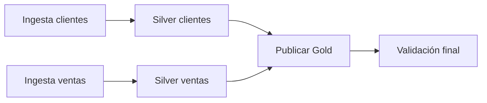

# 13 · Implementar Lakeflow Jobs

[Índice DP-750](../README.md) · [← Diseñar e implementar pipelines](../12-diseno-de-pipelines/README.md)

**Progreso personal:** Pendiente de estudio. [Módulo oficial](https://learn.microsoft.com/en-us/training/modules/implement-lakeflow-jobs/).

## Unidades

1. [Introduction](#unidad-01)
2. [Create job setup and configuration](#unidad-02)
3. [Configure job triggers](#unidad-03)
4. [Schedule a job](#unidad-04)
5. [Configure job alerts](#unidad-05)
6. [Configure automatic restarts](#unidad-06)
7. [Exercise - Implement Lakeflow Jobs with Azure Databricks](#unidad-07)
8. [Module assessment](#unidad-08)
9. [Summary](#unidad-09)

- [Desarrollo aplicado](#desarrollo-aplicado)
- [Laboratorio y comprobaciones](#laboratorio-y-comprobaciones)

## Unidad 01

### Introduction

Un **Lakeflow Job** es una definición de ejecución coordinada que se puede lanzar manualmente, programar o activar por eventos. Un job agrupa **tareas**, **dependencias**, **parámetros**, **recursos de cómputo**, **triggers**, **políticas de error** y **notificaciones**. Cada lanzamiento produce una **run** cuyo estado y resultados deben consultarse para determinar si el producto de datos es correcto.

Una tarea no equivale a todo el job: el job puede informar de fallo cuando una de sus ramas obligatorias no acaba correctamente. El significado de éxito también depende de las condiciones `Run if` y del tratamiento de tareas omitidas o canceladas.

[Unidad oficial](https://learn.microsoft.com/en-us/training/modules/implement-lakeflow-jobs/1-introduction)

## Unidad 02

### Create job setup and configuration

En la interfaz **Jobs & Pipelines**, un job puede incluir tareas del tipo Notebook, SQL y otros soportados. Para cada tarea se selecciona el archivo o consulta, el cómputo permitido y, opcionalmente, parámetros. Los parámetros del job sirven para cambiar fecha de proceso, mercado o un identificador de lote sin duplicar el código.

Usa nombres significativos como `process_cdrs`, `summarize_gold`, `validate_quality`. Mantén un propósito por tarea y evita repetir todo el pipeline en un notebook si solo necesitas ejecutar una fase. Las identidades usadas para ejecutar y leer datos deben recibir solo los privilegios necesarios.

Los **parámetros dinámicos** representan propiedades de una ejecución como su instante de disparo, pero la sintaxis concreta depende de la plataforma. Valida su sustitución en la vista del job y en el notebook sin asumir que se inserta automáticamente un formato compatible con tu parser.

[Unidad oficial](https://learn.microsoft.com/en-us/training/modules/implement-lakeflow-jobs/2-create-lakeflow-job)

## Unidad 03

### Configure job triggers

| Activación | Ventaja | Consideraciones |
|---|---|---|
| Manual | Ideal para pruebas y recuperaciones | Necesita intervención |
| Scheduled | Regularidad y planificación | Puede ejecutar sin datos nuevos |
| File arrival | Reacciona a nuevos ficheros | Debe controlarse acumulación y duplicados |
| Table update | Responde a modificaciones de tablas admitidas | Depende de soporte y permisos |

Los jobs activados por archivo pueden agrupar llegadas muy próximas mediante una espera de estabilización. Sin embargo, un job activado no implica que los archivos se procesen una sola vez: la deduplicación y el checkpoint pertenecen a la lógica de procesamiento.

**Expresiones cron:** Databricks puede usar sintaxis Quartz con campo de segundos, distinta del cron tradicional de Linux. Por ejemplo, `0 0 2 * * ?` representa una ejecución diaria a las 02:00 según la zona horaria configurada. Comprueba siempre los cambios de horario de verano y el calendario mostrado en la UI.

#### Disparadores de datos y concurrencia

Un trigger por llegada de archivos depende de una ubicación observable y de la compatibilidad del job con el origen. Un trigger por actualización de tabla responde a cambios en la tabla suscrita. Comprueba latencia de detección, condiciones para agrupar cambios y concurrencia de runs. Una ejecución que detecta varios archivos debe poder explicar cuáles procesó. El trigger inicia la ejecución. La lectura incremental, el checkpoint o el registro de lotes determinan qué queda pendiente cuando un evento provoca varias activaciones o la tarea se reintenta.

[Unidad oficial](https://learn.microsoft.com/en-us/training/modules/implement-lakeflow-jobs/3-configure-job-triggers)

## Unidad 04

### Schedule a job

#### Programa y valida una ejecución

Abre el job, selecciona el tipo de trigger programado y revisa zona horaria, frecuencia y expresión si utilizas configuración avanzada. Para una carga que sigue un cierre comercial peninsular, una hora local puede ser el requisito. Cuando el sistema espera intervalos constantes, UTC facilita el cálculo y evita ambigüedad por cambios de hora. Define qué ocurre si llegan ficheros tarde, el job anterior sigue en ejecución o se necesita un backfill. El momento del trigger y la fecha lógica del lote representan datos diferentes.

Valida en el historial una ejecución bajo la misma identidad y cómputo que se usarán programados. Comprueba hora planificada, hora real, parámetros de cada tarea y efecto en la tabla final. Si necesitas una prueba rápida, ejecuta manualmente con parámetros equivalentes y conserva la siguiente ejecución programada como prueba del trigger. Desactiva el job de prácticas al terminar o configura una frecuencia acorde al entorno.

[Unidad oficial](https://learn.microsoft.com/en-us/training/modules/implement-lakeflow-jobs/4-schedule-job)

## Unidad 05

### Configure job alerts

#### Alertas y señal operativa

Configura las notificaciones del job para avisar de un fallo final a quien pueda investigar la ejecución. Usa notificaciones a nivel de tarea cuando se necesite visibilidad de una fase particular, valorando ruido por reintentos. Una alerta de duración permite detectar cargas que siguen ejecutándose cuando ya comprometen el SLA. Registra un run de prueba con un fallo controlado y verifica que la notificación incluye un identificador que te lleva a la ejecución correcta. Para resolver el incidente, consulta tarea fallida, logs y salida, y compara con la última ejecución válida.

[Unidad oficial](https://learn.microsoft.com/en-us/training/modules/implement-lakeflow-jobs/5-configure-job-alerts)

## Unidad 06

### Configure automatic restarts

Las **notificaciones** de trabajo alertan por estados como error o duración excesiva. Las **políticas de retry** reejecutan una tarea cuando se produce un fallo recuperable; pueden incluir número máximo de intentos e intervalo. Una **advertencia de duración** no es lo mismo que un **timeout** que aborta la tarea al superar su límite.

La funcionalidad de reparación permite recuperar una ejecución fallida sin repetir necesariamente todos los pasos, según el tipo de tarea, dependencias y estado. Antes de reintentar, confirma si el fallo dejó resultados parcialmente escritos, pues una reparación sin operaciones idempotentes puede duplicar salidas.

Diseño recomendado: reintentos cortos para errores transitorios, notificación final si se agotan, y un procedimiento de diagnóstico que revise logs del notebook, políticas de ejecución y resultados parciales. Los correos deben dirigirse a un contacto real y autorizado de operaciones.

#### Reintento, ejecución continua y reparación

Los reintentos se configuran por tarea y sirven para fallos transitorios cuando es seguro volver a ejecutar la operación. Una carga cuyo merge aún no publicó puede reintentarse si la clave y la escritura conservan un resultado estable. Un error de permisos persistente necesita corregir el contexto de ejecución. La reparación se utiliza después de investigar el run y tiene en cuenta qué tareas deben volver a ejecutarse. Una carga continua persigue mantener un trabajo activo y usa el comportamiento de recuperación correspondiente. Valida ese comportamiento con la fuente y checkpoint que emplearás realmente.

[Unidad oficial](https://learn.microsoft.com/en-us/training/modules/implement-lakeflow-jobs/6-configure-job-automatic-restarts)

## Unidad 07

### Exercise - Implement Lakeflow Jobs with Azure Databricks

Considera registros de telecomunicaciones que llegan varias veces al día. En Bronze almacenas el lote y su identificador; Silver depura esquemas, fechas, duraciones y códigos; Gold agrega caídas de llamadas por zona y tecnología. El Job debe decidir cuándo actualizar Gold y con qué periodo de proceso.

La ejecución a las 02:00 puede ser razonable para un informe matutino, pero un trigger por archivos será mejor para requisitos de baja latencia. Si los datos pueden llegar tarde, diseña ventanas de reprocesamiento e implementa un `MERGE` o actualización controlada para los periodos afectados.

**Buenas prácticas de seguridad:** administra el propietario del job, revisa permisos de los objetos UC, evita secretos en widgets y controla quién puede editar triggers o reenviar resultados a destinos externos.

[Unidad oficial](https://learn.microsoft.com/en-us/training/modules/implement-lakeflow-jobs/7-exercise-implement-lake-flow-jobs)

## Unidad 08

### Module assessment

1. **¿Por qué una tarea SQL necesita una consulta guardada?** Porque el Job referencia un objeto de consulta configurado, no un bloque de SQL arbitrario en todos los modos.
2. **¿Qué ocurre al sustituir un trigger de llegada por uno cron?** La ejecución deja de depender de archivos y pasa a ocurrir a las horas programadas.
3. **¿Cuál es el riesgo de reintentar un append?** Repetir filas si no se conserva una clave de lote y deduplicación.
4. **¿De qué sirve la vista Runs?** Permite localizar errores, tiempos, parámetros y la tarea que bloqueó el pipeline.

[Unidad oficial](https://learn.microsoft.com/en-us/training/modules/implement-lakeflow-jobs/8-knowledge-check)

## Unidad 09

### Summary

Una programación de producción debe documentar trigger, zona horaria, Run as, concurrencia, política de reintentos, destino de avisos y procedimiento de reparación. Tras un fallo, distingue reintento automático, reparación de tareas y ejecución nueva de todo el job. Verifica los efectos de la carga anterior antes de elegir. Un paso que escribe por clave de negocio puede reintentarse con seguridad si mantiene un resultado estable y valida la cardinalidad de su entrada.

[Unidad oficial](https://learn.microsoft.com/en-us/training/modules/implement-lakeflow-jobs/9-summary)

## Desarrollo aplicado

### Job, tarea, ejecución y trigger

Un **job** define qué tareas deben ejecutarse y en qué condiciones. Una **tarea** puede referirse a un notebook, un pipeline u otro tipo de recurso soportado. Una **ejecución** es una instancia concreta del job o de una tarea y tiene estado, duración, parámetros y resultados. El **trigger** determina cuándo empieza: manual, programado u otros mecanismos disponibles. Estas entidades no son equivalentes: modificar la programación no cambia el código de una tarea y reiniciar un job no implica necesariamente borrar el estado de sus datos.

### Diseño de un DAG con dependencias

Supongamos que `ingest_clientes` y `ingest_ventas` pueden ejecutarse en paralelo. `silver_clientes` depende del primero; `silver_ventas` del segundo. `publicar_gold` depende de ambos, y una última tarea valida los indicadores publicados. Si solo una rama falla, el sistema debe ofrecer información suficiente para reparar la parte defectuosa sin repetir innecesariamente tareas costosas.

### Programaciones y zonas horarias

Una programación debe documentar zona horaria, calendario, objetivo de finalización y comportamiento durante cambios de horario. Un job a las 02:30 puede verse afectado por el cambio de hora si utiliza una zona con horario de verano. Para ejecuciones con datos diarios, conviene calcular una **fecha lógica de proceso** independiente de `current_timestamp()` y pasarla como parámetro. Así una reparación del día anterior procesa exactamente el periodo esperado.

### Concurrencia y deduplicación

Si una ejecución dura más que su intervalo de programación, puede coincidir con otra. Limitar concurrencia protege recursos y evita escrituras simultáneas incompatibles. Pero impedir solapamientos no sustituye la idempotencia: reintentos manuales, reparaciones y ejecuciones lanzadas por usuarios también deben gestionar entradas repetidas.

### Alertas, reintentos y recuperación

Configura notificaciones a responsables pertinentes y evita un exceso de alertas que termine ignorándose. Establece máximo de reintentos, intervalos y, cuando proceda, timeout. Un error de permisos no suele resolverse repitiendo diez veces; una indisponibilidad transitoria podría hacerlo. Después de una incidencia, determina qué datasets se escribieron y si los consumidores observaron un estado parcial.

### Checklist operativa

| Pregunta | Resultado esperado |
|---|---|
| ¿Quién ejecuta el job? | Principal autorizado y estable |
| ¿Qué datos procesa? | Parámetros y periodo definidos |
| ¿Cómo evita duplicados? | Idempotencia y claves verificadas |
| ¿Qué sucede si falla? | Estado visible, reintento o reparación controlados |
| ¿Cuándo se avisa? | Umbrales y destinatarios documentados |
| ¿Cómo se audita? | Logs, historial y enlaces a ejecuciones |

**Práctica:** configura en un entorno de pruebas un job con dos notebooks dependientes, un parámetro `fecha_proceso`, una alerta de fallo y una política de reintentos apropiada. Provoca una excepción controlada en la segunda tarea, observa los estados y practica la reparación. Finalmente registra la diferencia entre lanzar el job, reiniciar una ejecución completa y reparar únicamente tareas fallidas; la disponibilidad exacta de opciones depende de la interfaz y las funciones habilitadas.

## Laboratorio y comprobaciones

**Ejercicio oficial:** [Abrir las instrucciones de MicrosoftLearning](https://microsoftlearning.github.io/DP-750T00-Implement-Data-Engineering-Solutions-using-Azure-Databricks/Instructions/Labs/11-implement-lakeflow-jobs.html)  
**Notebook oficial:** [Importar o consultar notebook `.ipynb`](https://raw.githubusercontent.com/MicrosoftLearning/DP-750T00-Implement-Data-Engineering-Solutions-using-Azure-Databricks/refs/heads/main/Allfiles/11-implement-lakeflow-jobs.ipynb)  
**Naturaleza de esta sección:** itinerario explicado con redacción propia y comprobaciones de aprendizaje. Las celdas exactas y el material de origen están en el notebook oficial enlazado; no se reproducen íntegramente aquí.

### Caso práctico: TelConnect — automatización de registros CDR

**Necesidad:** una operadora de telecomunicaciones transforma llamadas y sesiones de datos (CDR) y necesita automatizar una salida Gold cada noche, con avisos cuando falla un paso.

**Parte A — preparar los datos:**

1. Importa el notebook y ejecútalo en cómputo compatible. El material crea `telconnect_lab` con `bronze`, `silver`, `gold`, un volumen `raw_uploads`, un CSV de CDR y tablas transformadas.
2. Revisa que la capa Gold contiene `network_summary` y que puedes consultar indicadores de llamadas y fallos por región y tipo de red. Localiza el widget o parámetro `processing_date` en el notebook.

**Parte B — construir y automatizar el job:**

3. Crea `TelConnect CDR Pipeline`. Primera tarea: `process_cdrs`, tipo Notebook, usando el notebook importado y un recurso de cómputo compatible.
4. Registra un parámetro de job `processing_date` y vincúlalo a la fecha de ejecución mediante la sintaxis dinámica que indique la UI actual; contrástala con el widget del notebook. Guarda y prueba una ejecución manual.
5. Crea una consulta SQL guardada que lea `telconnect_lab.gold.network_summary`, ordenada por tasa de llamadas caídas. Después añádela como segunda tarea SQL `summarize_gold`, dependiente del éxito de `process_cdrs`. La consulta debe estar **guardada previamente**; no se introduce SQL arbitrario directamente en la tarea.
6. Añade un **file-arrival trigger** sobre `/Volumes/telconnect_lab/bronze/raw_uploads/`, con un margen aproximado de **60 s** tras el último cambio para agrupar archivos próximos. Comprueba la compatibilidad de triggers con la ubicación y el plan disponibles.
7. Sustituye (no simplemente pauses) ese trigger por una ejecución diaria a las **02:00**, con zona **Europe/Amsterdam**. En el ejemplo oficial se utiliza la sintaxis cron Quartz `0 0 2 * * ?`; recuerda que no es la sintaxis cron de cinco campos de Linux y que el horario de verano afecta al UTC equivalente.
8. Configura **avisos por fallo**, opción para no notificar hasta agotar los reintentos y, en la tarea principal, **dos reintentos con 60 segundos** entre ellos. Estudia una advertencia a los **20 minutos** y timeout de **30 minutos**, donde la UI lo permita.
9. Ejecuta manualmente y revisa la sección Runs: ambas tareas, parámetros recibidos, ejecución descendente, logs y estado final. Conserva una captura del DAG como evidencia.

**Preguntas de cierre:** ¿cuándo elegirías disparo por archivo frente a cron?, ¿cómo impedir ejecuciones solapadas?, ¿qué pasa si el fichero se vuelve a procesar?, ¿qué diferencia hay entre fallo de tarea y fallo total del job?

**Costes:** deja en pausa el trigger y el trabajo de laboratorio si ya no necesitas la automatización.

### Prueba de la operación programada

Empieza por un run manual del notebook oficial con un valor de parámetro conocido. Apunta el identificador del run y confirma que las tareas dependientes consumen el valor previsto. Configura el trigger exigido en el ejercicio y revisa la siguiente ejecución. Después simula un fallo sobre una carga descartable y verifica notificación, reintentos y estado de las tareas downstream. Si la tarea utiliza un lote de datos, compara las filas antes del fallo y después de reparar. El dato observado debe corresponder al mismo lote y la publicación debe ser consistente. Pausa o retira el trigger de prueba al terminar y comprueba que el recurso de cómputo de prácticas no sigue activo por una ejecución anterior.

## Fuentes y navegación

- [Fuentes de la certificación](../FUENTES.md)
- [Preparación y limpieza del entorno](../PREPARACION-LABORATORIOS.md)

[Índice DP-750](../README.md) · [← Diseñar e implementar pipelines](../12-diseno-de-pipelines/README.md)
