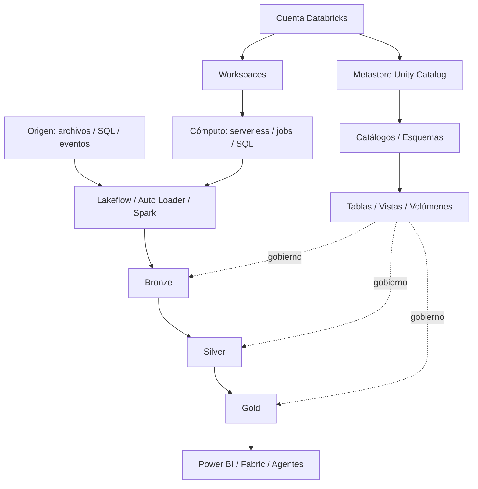

[🏠 Volver al índice](README.md)

# Glosario y repaso transversal de los diez primeros módulos

## 1. Glosario de conceptos esenciales

| Concepto | Explicación breve |
|---|---|
| **Account** | Límite administrativo superior de Databricks. |
| **Workspace** | Entorno colaborativo de trabajo y ejecución. |
| **Metastore** | Registro central de metadatos gobernados. |
| **Unity Catalog** | Sistema de organización, permisos y gobierno de datos. |
| **Catalog / Schema / Object** | Tres niveles de denominación de objetos. |
| **Control plane** | Configuración, interfaz y coordinación del servicio. |
| **Compute plane** | Infraestructura donde se ejecutan trabajos sobre datos. |
| **Serverless** | Cómputo gestionado por la plataforma. |
| **SQL warehouse** | Motor de consulta y BI basado en SQL. |
| **Photon** | Aceleración vectorizada para operaciones compatibles. |
| **Delta Lake** | Formato de tabla transaccional para análisis. |
| **Managed table** | Tabla cuyo ciclo de vida físico gobierna Unity Catalog. |
| **External table** | Tabla registrada sobre archivos externos administrados por otro actor. |
| **Volume** | Objeto gobernado para archivos no tabulares. |
| **Storage credential** | Identidad o mecanismo de acceso a almacenamiento externo. |
| **External location** | Ruta de almacenamiento más credencial autorizada. |
| **RBAC / ABAC** | Control basado en roles / basado en atributos y políticas. |
| **Row filter** | Regla que condiciona las filas visibles. |
| **Column mask** | Regla que altera el valor mostrado de una columna. |
| **Lineage** | Procedencia y dependencias de activos de datos. |
| **Time travel** | Consulta histórica de versiones conservadas de una tabla Delta. |
| **SCD2** | Técnica para mantener filas históricas de una dimensión. |
| **CDC** | Captura de inserciones, actualizaciones y borrados de origen. |
| **Structured Streaming** | Procesamiento incremental con Spark. |
| **Auto Loader** | Detección y carga incremental de archivos. |
| **Checkpoint** | Estado persistente de progreso de un stream. |
| **Medallion** | Separación conceptual Bronze / Silver / Gold. |
| **Lakeflow** | Familia de capacidades para conexión, pipeline y orquestación. |

## 2. Mapa conceptual integrado

## 3. Repaso cruzado: preguntas tipo examen (elaboración propia)

1. Hay que separar datos de desarrollo y producción, pero centralizar sus permisos. ¿Qué combinación usarías de workspaces, catálogos y metastore?
2. Una tabla Delta externa se elimina del catálogo. ¿Qué sucede con los archivos y por qué?
3. Un panel recibe cientos de consultas SQL. ¿Qué recurso está especialmente diseñado para servirlas?
4. Un pipeline de clientes requiere conocer la ciudad exacta en la fecha de cada pedido. ¿SCD1, SCD2 o solo time travel?
5. Un proceso necesita acceder a ADLS sin guardar secretos en notebooks. ¿Qué mecanismo de identidad priorizarías?
6. Una tabla tiene 50 millones de filas y se filtra por fecha; ¿cómo evaluarías particionado o clustering?
7. Una tarea de streaming se reinicia y vuelve a cargar todos los eventos. ¿Qué configuración revisarías?
8. Se crea una vista con datos sensibles. ¿Por qué no basta con su nombre para garantizar seguridad?
9. Un `LEFT JOIN` duplica la suma de ventas. ¿Qué investigarías primero?
10. Una columna monetaria tiene diferencias mínimas de redondeo. ¿Por qué conviene `DECIMAL`?
11. ¿Qué diferencia hay entre un catálogo foráneo y una tabla managed?
12. ¿Qué debe revisarse al presentar tablas de Unity Catalog en Fabric si existen máscaras de columnas?

### Respuestas razonadas abreviadas

1. Separar entornos mediante workspaces y/o catálogos, gobernando con Unity Catalog y reglas explícitas; añadir bindings cuando proceda.
2. El registro se elimina; el ciclo de archivos lo conserva el propietario externo.
3. SQL warehouse, con tamaño y escalado elegidos según concurrencia real.
4. SCD Tipo 2 u otro modelo histórico persistente que preserve validez temporal; time travel depende de retención.
5. Managed identity cuando la integración admita ese mecanismo y se otorguen roles mínimos.
6. Estudiar volumen, cardinalidad, tamaños de archivo, filtros reales y coste de mantenimiento antes de decidir.
7. Checkpoint, su ubicación persistente y la semántica del origen/destino.
8. Es preciso configurar privilegios y políticas efectivas, no confiar en la presentación lógica de la vista.
9. La cardinalidad y duplicados en las claves de unión.
10. Para representar con exactitud decimal cantidades donde la precisión monetaria importa.
11. El catálogo foráneo consulta otro sistema; la tabla managed delega el ciclo de sus archivos a Unity Catalog.
12. La identidad usada y si los controles de Unity Catalog se trasladan realmente al mecanismo Fabric seleccionado.

## 4. Plan para seguir ampliando este README

Al incorporar nuevas unidades o certificaciones, mantener: **(1)** URL del módulo; **(2)** relación completa de unidades; **(3)** teoría explicada con lenguaje propio; **(4)** código probado y requisitos; **(5)** preguntas de repaso; **(6)** fecha de revisión. Las prácticas de Microsoft Learn pueden depender de recursos temporales, suscripciones y permisos; si no se ejecutan, señalarlas como *propuesta de laboratorio*, no como práctica verificada.

---

> Las preguntas son elaboraciones propias, no preguntas oficiales de examen.
